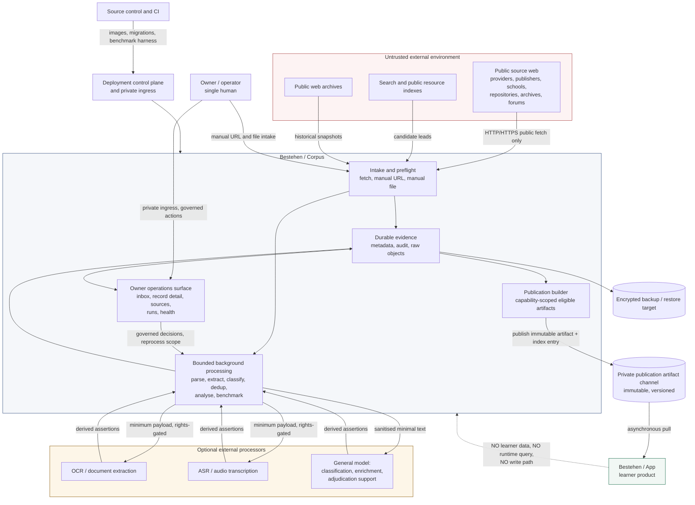
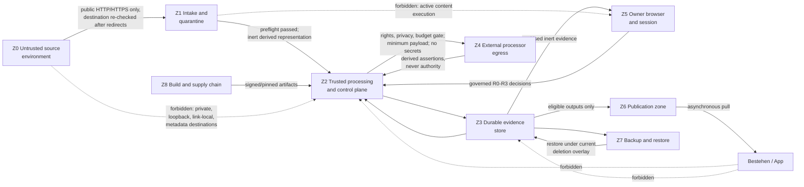

# Bestehen / Corpus — Stage 02: System Context and Product Boundaries

- **Status:** Accepted architecture context
- **Date:** 2026-08-27
- **Owning stage:** Stage 02 of 28
- **Applies to:** every later Corpus architecture artifact, ADR, domain/data model, pipeline, security control, operations surface, publication contract, test plan and deployment decision
- **Durable operating decision:** [ADR-0001](adr/ADR-0001-offline-first-reuse-first-operating-model.md)
- **Durable boundary decision:** [ADR-0002](adr/ADR-0002-one-way-asynchronous-corpus-to-app-publication-boundary.md)
- **Implementation status:** architecture only; no production code, infrastructure, account, resource, key, bucket, deployment, dashboard or provider call was created

## 1. Purpose, scope, and non-implementation boundary

Stage 01 fixed how decisions are judged. Stage 02 fixes **where the system ends**: who and what interacts with Corpus, which direction each interaction travels, which trust zone each participant occupies, which paths are batch or on demand, and which paths must not exist at all.

This artifact is complete when a later stage can locate any actor, path, dependency or trust boundary without re-reading product shaping, and can tell immediately whether a proposed component sits inside Corpus, outside it, or on a boundary that requires a control.

This stage deliberately does **not** select a language, framework, database product, object layout, queue technology, crawler, OCR/ASR/model vendor, endpoint style, packaging format, signature algorithm, deployment topology, resource name or region. It also does not provision anything. Those belong to Stages 03, 05, 06, 11–15, 19–20 and 23–26 and must satisfy the boundaries fixed here.

Normative words follow Stage 01 §1: **MUST/MUST NOT** is a hard gate; **SHOULD** is the default requiring measured evidence to deviate; **MAY** is an allowed choice.

## 2. Inputs, source cuts, authority, and reconciliation

### 2.1 Repository source cuts

| Repository | Current main commit read | Role |
|---|---|---|
| m-elsharkawi/Bestehen-Shaping | f9a468ee63a4c4c778b1a535e13c419bb50cd703 | Read-only product truth |
| m-elsharkawi/Bestehen-Corpus | 826da2bc1011ea15c5ff56191c5f2c3fb21a3ff1 before Stage 02 writes | Architecture target; `Design/` read-only |
| m-elsharkawi/Bestehen-App | c39ec9c1ecb3a3dd2220ea28f7f71ecf88322cf8 | Read-only implementation/integration reference |

### 2.2 Mandatory input manifest

| Repository path | Blob SHA read | Use |
|---|---|---|
| Bestehen-Shaping/corpus/01-product-mission-and-boundaries.md | 180900725eefd27ad9b5f50456efdc7dd30b02e9 | Primary customer, ownership boundary, non-goals, offline-intelligence rule |
| Bestehen-Shaping/corpus/02-source-strategy.md | 7b38c9756fa39b63b7389c8c1e0a79dbe89ef6d4 | Source families, discovery/manual intake paths, formats, no-circumvention rule |
| Bestehen-Shaping/corpus/12-corpus-app-contract.md | 7add217f62118e5abe100680d2e8230a93b8c280 | Capability contract, pattern-first default, responsibility matrix, versioning |
| Bestehen-Shaping/corpus/15-security-privacy-and-abuse-boundaries.md | fee944281e46ecb48febd89dec269d5f302c2431 | Untrusted input, egress limits, authority model, retention, future triggers |
| Bestehen-Shaping/corpus/17-bestehen-corpus-product-specification.md | 537b5185313097d043748f9dc9f9fdaf432ee71d | Consolidated Corpus authority, launch requirements, open architecture list |
| Bestehen-Shaping/app/28-bestehen-app-product-specification.md | 18ae80cc2fd63cecd76c297c3e56d44a68367856 | App product boundary and Corpus→App product contract §14.2 |
| Bestehen-Corpus/Architecture/00-architecture-shaping-plan.md | 5c13d2f5d5f6b85c966508a97a9cded6c6f443d5 | Workflow, authority order, ADR and research rules |
| Bestehen-Corpus/Architecture/00-app-implementation-tooling-and-account-reuse-policy.md | d93c6084aa6b5603a86fdc080c1f70aa91ca2cc8 | Mandatory reuse/no-provisioning policy |
| Bestehen-Corpus/Architecture/01-architecture-charter-and-quality-attributes.md | 500cc8f9644ed80c02fcce3f6fff94a3c25eab3b | Principles, quality scenarios, precedence, reuse template, degradation |
| Bestehen-Corpus/Architecture/adr/README.md | ceebba371f15337bd4fb7a30ab6461bb9f0aa888 | ADR criteria, template and next number |
| Bestehen-Corpus/Architecture/adr/ADR-0001-offline-first-reuse-first-operating-model.md | ffd0970cf3ac27ace033fa7d674e9d0bc7cf6048 | Accepted operating model constraining this stage |
| Bestehen-Corpus/Bestehen_Corpus_Architecture_Checklist.md | 51bf81947ef5e76c37869716c8cdb21d6d3f78d6 | Complete Stage 02 section read before deciding |
| Bestehen-Corpus/Design/DESIGN-HANDOFF.md | fc573707efcf0c632384dfc1fd45ab6595b11369 | Observable states, authority contracts, risk tiers, honest gaps |
| Bestehen-Corpus/Design/Corpus-00-Cover-Principles.dc.html | 607677ae02534c27ce5c42c965e31d10591f4c04 | Six axes, information architecture, 41-surface inventory, deliberately-absent list |
| Bestehen-Corpus/Design/Corpus-04-Desktop-Screens.dc.html | ef69c8585b04f61ec1b35ff0b47d97f9611037d3 | Intake, runs, health, cost and Corpus→App impact surfaces |
| Bestehen-Corpus/Design/Corpus-07-Flows.dc.html | badd43f944e2dc5d7cabdb6f8d61688937a6425d | Flows A–H, recovery branches, eight cross-flow guarantees |
| Bestehen-Corpus/prompts/architecture/02_define_system_context_and_product_boundaries.txt | f90baeca5a2009fb0af18fc733aef3e9b9d6c5ed | Current executable Stage 02 instructions |
| Bestehen-App/Implementation/Personal/02-provider-service-setup/handoff.md | f538df5be3ada4c26891e3f4a2ab1d800f244f24 | Accepted provider/runbook baseline and readiness caveats |
| Bestehen-App/docs/setup/personal/README.md | 269542c44492bbd2b6df3492c1e7dea9312530b6 | Safe sequence, private boundaries, least-privilege roles, residency observations |
| Bestehen-App/.env.example | ad6187c9c64a6d8eea1845e449f2a3f766d22a28 | Configured-group conventions, fake-first defaults, paid-envelope gating |
| Bestehen-App/Architecture/10-corpus-integration-compatibility-cache-and-rights.md | d4e1ab25e359dcfcc506ee29462760a41647138d | Accepted counterpart integration boundary and its obligations on Corpus |
| Bestehen-App/Architecture/12-api-contracts-jobs-events-and-idempotency.md | c640da01d6eb6d71a5e2ea7a0dcf19147d6d7528 | Import idempotency, sequence and payload-minimisation constraints |
| Bestehen-App/Architecture/28-bestehen-app-architecture-specification.md | 89a761d64767e048b59338ec13e61b1b06472dbd | Consolidated App boundary statement and prohibited shortcuts |

The nine numbered App setup guides `docs/setup/personal/01-github.md` … `09-staging-readiness.md` were inspected through the runbook index for the Coolify, Pangolin, R2, Auth0, SES and AI boundaries used in §11.

### 2.3 Authority order applied

Corpus Stage 17, then delegated Corpus stages, then umbrella overview and identity, then Corpus design, then the App counterpart. Product truth beats design expression. App architecture constrains the **current counterpart interface** but cannot redefine Corpus semantics.

### 2.4 Reconciliation of current state

Four current-state facts required explicit reconciliation. None is an owner blocker.

1. **App main advanced since the Stage 01 cut.** Stage 01 read Bestehen-App at `cb2e9a7a…`; current main is `c39ec9c1…`, 32 commits later. Personal implementation Stage 02 (provider setup) and Stage 03 (domain/data/jobs/identity) are now merged into App main, and Stage 04 planning is accepted. `.env.example` changed from blob `015c5e1c…` to `ad6187c9…`.
2. **Repository progress is still not live-resource readiness.** Both App handoffs state their execution was accepted but "not merged, deployed, or service-ready" / "not merged, deployed, or live-verified", and the App personal implementation checklist line *"GitHub, Coolify, Pangolin, R2, Auth0, SES, AI/STT/TTS, secrets, budget, backup, and recovery guides are verified"* remains unchecked. Corpus therefore records every reused provider/account row in §11 as `owner_pending` and MUST NOT claim a verified live resource anywhere. Stage 01 §2.3 remains correct; only the merge status changed.
3. **"App requests a pattern" is a conceptual capability, not a transport claim.** Corpus Stage 12 §4.8/§4.14 describes App asking Corpus for a desired practice pattern, and explicitly says these are "conceptual product capabilities, not mandated endpoints"; Corpus Stage 17 §7.3 leaves API transport open. The accepted App counterpart resolves that request locally against an imported snapshot (`ARCH-S10-D07`). Resolving a conceptual request locally from published intelligence satisfies the product contract, so there is no contradiction. Recorded for Stage 19.
4. **Design and product agree on absence.** Design page 00.4 "Deliberately absent" (no learner data, no public browser, no source mirror, no public API console, no submissions from anyone but the owner, no roles/approvals/SLA/billing/collaboration) matches Corpus Stage 17 §1.5 and §7.2 and the Stage 15 hardening triggers. The design's benchmark-not-instantiated presentation is unchanged and remains a Stage 21 obligation.

## 3. Stage 02 decision register and traceability

| ID | Decision | Principal alternative rejected | Governing product/design/architecture source | Downstream owners |
|---|---|---|---|---|
| CTX-D01 | Corpus is one logical system with bounded background processing, one owner-only operations surface, and one outbound publication artifact channel. It has no public surface of any kind. | A set of independently operated services, or a public-facing Corpus product | corpus/01 §3.6, corpus/17 §1.5, Architecture 01 P7, ADR-0001 | 03, 11, 20, 26 |
| CTX-D02 | The actor set is closed at launch: owner/operator, Corpus automation, Bestehen / App, the untrusted source web, optional external processors, and platform services. Learner, public submitter, second operator, external API consumer, paying customer and exam provider-as-authority are named **non-actors**. | Leaving future actors implicit and "designing seams just in case" | corpus/01 §3.7, corpus/15 §3.11/§3.13, corpus/17 §1.5/§7.2, Design 00.4 | 06, 19, 20, 23 |
| CTX-D03 | Eight trust zones with directional crossing rules (§6). Source content and model output never acquire authority; no zone may collapse the six truth axes. | A single "internal/external" split, or trusting official sources more at the security layer | corpus/15 §3.2/§3.3/§3.8, Design handoff §4.10, Architecture 01 §4.1 | 06, 11–15, 20, 23, 25 |
| CTX-D04 | Seven present paths and one explicitly absent learner-runtime path (§7). There is no inbound path from App, no public inbound path, and no third-party callback path. | An App-callable Corpus service, or a public submission endpoint | corpus/01 Rule 9, corpus/15 §3.11/§3.13, corpus/12 §1.3 | 06, 11, 19, 23 |
| CTX-D05 | The Corpus→App boundary is a **one-way asynchronous publication** of precomputed, capability-scoped, eligibility-carrying artifacts that App pulls. Corpus exposes no synchronous App-facing query or inference surface at launch. | Synchronous capability API; shared database; hybrid API plus artifacts | corpus/12 §3.1–§3.3, corpus/17 §4.11, app/28 §14.2, App `ARCH-S10-D01` | 19, 23, 24, 26, 27; **ADR-0002** |
| CTX-D06 | The learner-data boundary is deny-by-schema, not policy text: no Corpus intake, storage, job, log or publication structure may contain a learner identifier, attempt, response, mastery, Readiness, exposure, exam date, preference or device identifier. | Accepting pseudonymous learner references "for calibration" | corpus/15 §3.1, corpus/12 §4.15, app/28 §14.2, App `ARCH-S10-D07` | 04, 05, 18, 19, 23, 25 |
| CTX-D07 | The current App implementation/account boundary is the Corpus **reuse context**: GitHub/Actions, the existing two-VM Coolify boundary, Pangolin private ingress, container packaging, PostgreSQL, Cloudflare R2 EU, existing AI/STT account relationships, existing secret custody. Corpus plans separate least-privilege resources inside those accounts and adds no new vendor at context level. | A standalone Corpus control plane and vendor set | Architecture 00 reuse policy §2–§3, ADR-0001, App runbook README | 03, 05, 19, 22–26 |
| CTX-D08 | No always-on Corpus process is required by any product promise. Only the published artifact store must be durably readable by App; Corpus compute may be absent without downstream effect. | Always-on workers, schedulers or an availability-managed Corpus API | corpus/01 Rule 9, corpus/17 §1.5 "not an always-on AI service", reuse policy §5 | 11, 24, 26 |
| CTX-D09 | External processors are optional, deferrable, minimum-payload egress destinations gated by rights, privacy, security and budget. Their unavailability defers work and never becomes corpus truth. | Treating a provider as a required pipeline stage | corpus/15 §4.3, corpus/17 §4.13.2, Architecture 01 QA-AVL-01/P9 | 12–15, 22, 24 |
| CTX-D10 | Launch exclusions are recorded with named triggers, first architecture consequence and owning stage (§13). | Silent deferral, or partial pre-building of deferred capabilities | corpus/15 §4.6/§4.7, corpus/17 §7.2 | 06, 19, 20, 23, 26 |
| CTX-D11 | Degradation is bidirectionally decoupled: Corpus outage is invisible to App; App outage delays publication only; publication-channel outage blocks new imports, never existing App inventory. | Fail-closed coupling, or treating provider failure as evidence | Architecture 01 §11, App `ARCH-S10-D09`, Design flows cross-guarantees | 19, 24, 26, 27 |
| CTX-D12 | Ten end-to-end scenario probes (§16) are the context-level observability anchors reused by Stage 27. | Leaving end-to-end proof to "Stage 25 will test it" | Architecture 01 §16.1, Design page 07 flows A–H | 24, 25, 27 |

## 4. Actors, external systems, and responsibility ownership

### 4.1 Present actors

| ID | Actor | Class | Interaction with Corpus | Authority ceiling |
|---|---|---|---|---|
| A1 | Owner / operator | Human, single | Authenticated private access to the operations surface; governed R0–R3 actions; manual URL and file intake | Highest human authority; cannot bypass audit; R3 actions need explicit typed scope confirmation |
| A2 | Corpus automation: rules, models, importers, reprocessors | Internal non-human | Executes assigned pipeline work; produces observations, derivations, findings, candidate states | Proposes only; may never clear a hard block, overwrite a curated decision, publish, or widen its own credentials |
| A3 | Bestehen / App | External downstream system | Pull-only consumer of published capability artifacts | Read the publication channel; no write path, no Corpus database access, no operator control, no raw source store |
| A4 | Public source web: official providers, publishers, schools/teachers, repositories/archives, unofficial collections, public forums and shared documents, exercise portals | Untrusted external | Serves HTTP/HTTPS documents, media and archives on request | None. Source bytes and extracted text are inert data with zero authority |
| A5 | Web search and public resource indexes | Untrusted external | Receives targeted discovery queries; returns candidate leads | None; results are candidates, never accepted evidence |
| A6 | Public web archives | Untrusted external | Historical snapshots of known URLs | None; a snapshot is an observation of a URL, not a new work |
| A7 | External OCR / document-extraction processor | Optional external processor | Receives minimum page images or segments; returns derived text/layout | Output is a derived assertion subject to QA and human override |
| A8 | External ASR / audio processor | Optional external processor | Receives bounded source audio segments; returns transcripts/timings | Same as A7 |
| A9 | External general model | Optional external processor | Receives sanitised minimal source text for classification, enrichment or adjudication support | Same as A7; source text inside a payload is quoted data, never instruction |
| A10 | Object storage service | Platform | Stores raw source bytes, derived assets, publication artifacts, encrypted backups | No semantic authority; deletion/takedown state dominates restore |
| A11 | Relational store | Platform | Canonical metadata, revisions, findings, audit, job state | Durable truth of record for metadata and audit |
| A12 | Source control and CI | Platform | Holds Corpus code, workflows, benchmark harness, architecture artifacts | Never holds source exam bytes, secrets, private identifiers or owner identity |
| A13 | Deployment control plane | Platform | Builds/runs Corpus containers on existing capacity | Operational only |
| A14 | Private ingress | Platform | Owner-only private route to the operations surface | Network authorisation only; not a substitute for in-app authority tiers |
| A15 | Backup / restore target | Platform | Encrypted copies of metadata and selected evidence | Restore must re-apply current deletion, takedown and prohibition overlays |
| A16 | Later design/architecture/analysis agents | Internal secondary consumer | Read structured evidence and architecture artifacts | Read-only; no governed action authority |

### 4.2 Named non-actors at launch

| ID | Non-actor | Why absent | Trigger that would create it |
|---|---|---|---|
| N1 | Learner | Corpus is not a learner product and owns no learner state | None. Creating it would contradict corpus/01 §3.7 and corpus/15 §3.1 |
| N2 | Public or third-party submitter | Manual submission is owner-only at launch | Deliberate product decision to accept outside submissions (corpus/15 §3.14) |
| N3 | Second write-capable human operator | One-owner authority model; no RBAC paid for early | A second operator receives write access (corpus/15 §3.11) |
| N4 | External API consumer, researcher, data customer | No public API, research UI or export product at launch | Explicit product expansion (corpus/17 §7.2) |
| N5 | Authenticated paid/private crawling counterparty | No third-party credential storage; lawful gated material enters by manual file intake | Decision to automate authenticated crawling (corpus/15 §3.10) |
| N6 | Billing / subscription / quota actor | No commercial product surface | Commercialisation (corpus/15 §4.6) |
| N7 | Exam provider as authority or affiliate | Corpus claims no affiliation, certification or official scoring | Never as an architecture decision; a licensing relationship would be a product decision |
| N8 | Advertising, product analytics or tracking third party | Near-zero personal-data footprint; no learner analytics exist to send | None foreseen |
| N9 | Collaboration actors: assignees, reviewers, approvers, comment threads, SLA clocks | One-owner console with no assignment model | Multi-operator trigger N3 |

### 4.3 Ownership matrix at context level

| Responsibility | Corpus | Bestehen / App |
|---|---|---|
| Source discovery, acquisition, provenance | **Owns** | None |
| Authenticity, confidence, rights, takedown state of source-derived material | **Owns** | Enforces returned conditions in learner-facing use |
| Canonical exam structure, taxonomy, difficulty/relevance, independence | **Owns** | Consumes; never recalculates |
| Capability eligibility of Corpus-derived outputs | **Owns** | Applies its own separate approval on top |
| Publication artifacts, versions, migrations, change impact | **Owns** | Imports, validates, promotes, reconciles |
| Learner identity, attempts, evidence, Readiness, coaching, session planning | None | **Owns** |
| Original learner-facing exercise generation, QA, delivery, evaluation | None | **Owns** |
| Repair of learner state after a Corpus change | Publishes affected scope and impact class | **Owns the repair** |

## 5. C4-style system context

The diagram shows the system in context: one Corpus system, its owner, its untrusted source environment, its optional processors, its platform services and its single downstream consumer. Every arrow is directional; there is no arrow into Corpus from App or from the public.



Three properties of this context are load-bearing:

1. **The only Corpus egress that a downstream product depends on is an artifact store**, not a Corpus process.
2. **Every inbound arrow originates from either the owner or an untrusted source**, and both are subject to the same preflight and inertness rules.
3. **The dotted App arrow is a prohibition, not a channel.** It exists in the diagram so later stages cannot quietly add it.

## 6. Trust zones and boundary-crossing rules

### 6.1 Zone model

| Zone | Contents | Trust posture |
|---|---|---|
| Z0 Untrusted source environment | Public web origins, fetched bytes, archive members, extracted text, model output derived from source text | Hostile by assumption. Reputation, officiality and owner submission grant no security trust |
| Z1 Intake and quarantine | Fetch execution, destination checks, preflight, bounded archive expansion, content addressing, quarantine holds | Handles hostile input; holds no broad credentials; performs no semantic decision |
| Z2 Trusted processing and control plane | Job orchestration, deterministic processing, rules, governance state transitions, audit writing | Holds Corpus credentials; never renders or executes source content |
| Z3 Durable evidence store | Canonical metadata, revisions, findings, audit history, raw and derived objects | Truth of record; retention and deletion classes differ per material class |
| Z4 External processor egress | Requests to OCR/ASR/model providers and their responses | Outside Corpus control; receives minimum payload; returns derived assertions only |
| Z5 Owner browser and session | Private ingress, operations surface, inert sanitised previews, risk-tiered confirmations | Privileged human context; must never execute source-supplied behaviour |
| Z6 Publication zone | Built capability artifacts, governance envelopes, migration and impact records, publication index | Outbound only; contents are eligible-by-construction and non-reconstructive by default |
| Z7 Backup and restore | Encrypted copies of metadata and selected evidence | Restore is a governed action that must re-apply current deletion and prohibition state |
| Z8 Build and supply chain | Repository, CI workflows, dependency and container provenance, deployment control plane | Trusted-but-verified; holds no source exam bytes, secrets or private identifiers |



### 6.2 Crossing rules

| Crossing | May cross | Required control class | MUST NOT cross |
|---|---|---|---|
| Z0 → Z1 | Public HTTP/HTTPS responses to Corpus-initiated fetches | Scheme allowlist, destination and redirect re-evaluation, host/source block state, pacing and etiquette, size bounds, no credentials in requests | Any non-web scheme; any private, loopback, link-local or metadata destination; any access-controlled resource requiring circumvention |
| Owner → Z1 | Manual URLs and lawfully obtained files | Same preflight as automated intake; submission origin recorded; owner identity is not a safety warrant | An assumption that owner-supplied material is safe or authentic |
| Z1 → Z2 | Content-addressed payload references, format/type findings, quarantine state, safe derived text | Preflight completion, bounded archive expansion, type/magic agreement, malicious-file screening, duplicate fingerprint lookup | Unclassifiable or unbounded payloads; executed macros, scripts or binaries |
| Z2 → Z3 | Observations, revisions, derivations, findings, audit events | Immutability of observations, append-only audit, governing version stamping | Silent overwrite of an observation or an audit record |
| Z2 → Z4 | Minimum page, segment or sanitised text needed for the capability | Rights/terms gate, privacy minimisation, budget gate, no secrets in payload, provider response treated as untrusted derived data | Whole documents when a segment suffices; secrets; unnecessary personal data; content whose rights forbid that processing route |
| Z3 → Z5 | Inert sanitised evidence, structured state, audit history | Sanitisation with scripts/embeds/forms/iframes/handlers removed rather than disabled; non-focusable preview; marker + word + hue for every state | Live source rendering; any control whose value is set by source-derived text |
| Z5 → Z2 | Governed decisions with actor, scope, rationale, risk tier | Risk-tier confirmation, enumerated scope before commit, audit write, stronger-control precedence | Bulk publish, bulk quarantine, bulk rights or takedown actions; reversal of a stronger block by a weaker control |
| Z3 → Z6 | Capability-eligible outputs, governance envelopes, migrations, impact records; exact assets only under explicit action rights | Eligibility evaluation per capability, non-reconstructive default, integrity and version stamping | Raw source bytes by default; restricted expression; operator material; secrets; internal rights reasoning intended for owner eyes |
| Z6 → App | Immutable versioned artifacts and their index | Read-only least-privilege consumer credential; integrity verification by the consumer; monotonic publication ordering | Any learner data; any Corpus write capability; any live query |
| Z3 → Z7 → Z3 | Encrypted backups and governed restores | Encryption at rest, protected key custody, restore re-applies current deletion/takedown overlay | Restoration of purged or prohibited expression into active use |
| Z8 → Z2 | Pinned images, migrations, benchmark harness | Dependency and image provenance, pinned versions, rollback path | Source exam bytes, secrets, private identifiers, owner identity in the repository or CI logs |

**Zone invariant.** No zone boundary may be used to compress the six axes. A record that crosses into Z6 carries provenance, confidence, rights, difficulty/relevance, QA readiness and identity/independence as separate fields with their own uncertainty; a single "safe to use" flag at any boundary is a Stage 01 §9 forbidden shortcut.

## 7. Path classification

### 7.1 Present paths

| ID | Path | Trigger | Timing class | Zones traversed | Notes |
|---|---|---|---|---|---|
| P1 | Discovery | Scheduled revisit, coverage gap, owner request | Batch / deferred | Z0 → Z1 | Produces candidates only. Registry-driven, targeted, bounded link neighbourhoods; never a recursive web-wide crawl |
| P2 | Acquisition and intake | Accepted candidate; manual URL; manual file | Batch, with on-demand manual entry | Z0/owner → Z1 → Z2/Z3 | One preflight and one provenance model for all three intake routes |
| P3 | Offline processing and enrichment | Queued work, reprocess scope, dependency change | Batch, resumable, replayable | Z2 ↔ Z3, optional Z4 | Cheap deterministic work first; paid escalation is bounded and deferrable |
| P4 | Owner operations | Owner session | Interactive, with long work demoted to background jobs | Z5 ↔ Z2/Z3 | No indefinite spinner; every long action is leavable and reports through a job tray |
| P5 | Benchmark and evaluation | Release candidate, method change, incident replay | On demand / release-gated | Z2 ↔ Z3 | Isolated, versioned, disjoint holdout; qualification is per capability and per slice |
| P6 | Corpus → App publication | Eligible output set changes; governed impact | Asynchronous, one-way | Z3 → Z6 → App | Build, version, make immutable, index, let App pull. See ADR-0002 |
| P7 | Backup, restore and audit export | Schedule, drill, incident | Scheduled / on demand | Z3 ↔ Z7 | Restore is governed and deletion-aware |

### 7.2 Absent paths

| Absent path | Why it must not exist | Enforcement owner |
|---|---|---|
| Learner runtime path: any route from a learner session, device or attempt into Corpus | Corpus owns no learner state and must not be on any per-session critical path | 19, 23, 25 |
| App → Corpus write, command or callback path | App is a pull consumer only; a write path would let a downstream product mutate evidence | 19, 23 |
| Public inbound path: submissions, API, research UI, source browser | Launch is internal-only; a public surface changes the threat, rights and privacy model | 20, 23 |
| Third-party webhook or provider callback into Corpus | Corpus initiates every external interaction; inbound callbacks would create an unauthenticated attack surface | 12, 22, 23 |
| Authenticated or credentialed crawling path | No third-party account secrets are stored; lawful gated material arrives as a manual file | 06, 23 |
| Outbound notification path to any non-owner recipient | There is no audience for Corpus notifications besides the owner, who uses the console | 20, 24 |
| Any path that carries learner identifiers or attempts in either direction | Deny-by-schema boundary CTX-D06 | 04, 05, 19, 25 |

### 7.3 Discovery to publication, end to end

```mermaid
sequenceDiagram
  autonumber
  participant SRC as Source web (Z0)
  participant IN as Intake and preflight (Z1)
  participant JOB as Processing (Z2)
  participant EXT as External processor (Z4)
  participant ST as Evidence store (Z3)
  participant OP as Owner console (Z5)
  participant PUB as Publication channel (Z6)
  participant APP as Bestehen / App

  JOB->>SRC: scheduled discovery within registry and bounded neighbourhood
  SRC-->>IN: candidate lead
  OP->>IN: manual URL or lawfully obtained file
  IN->>IN: destination, type, size, archive, fingerprint, block-state preflight
  alt preflight cannot bound or classify the payload
    IN->>ST: quarantine with security state and reason
    IN-->>OP: hold appears in the inbox; no deep processing occurs
  else preflight passes
    IN->>ST: content-addressed observation with provenance
    ST->>JOB: queue deterministic processing
    JOB->>ST: structure, findings, provisional classifications
    opt deterministic result insufficient and gates permit
      JOB->>EXT: minimum segment, rights and budget gated
      EXT-->>JOB: derived assertion with method/model version
    end
    JOB->>ST: derivations, per-capability eligibility, audit events
    ST-->>OP: prioritised exceptions with enumerated scope
    OP->>ST: governed decision with rationale and risk tier
    ST->>PUB: build capability-scoped eligible artifact set
    PUB-->>APP: asynchronous pull of immutable versioned artifacts
  end
  Note over APP,PUB: No learner data travels in either direction. Corpus is never called during a learner session.
```

## 8. Learner-data-free and no-live-inference boundary proof

The prohibition is structural, not procedural. Later stages MUST be able to demonstrate each of the following.

| Proof | Statement to be proven | Observable evidence | Owning stages |
|---|---|---|---|
| B1 | No Corpus schema, intake structure, job payload, log field or publication field can represent a learner identifier, attempt, response, mastery, mistake, Readiness, exposure, exam date, preference, fatigue or device identifier | Schema review plus negative serialisation tests that reject such fields rather than ignoring them | 04, 05, 19, 25 |
| B2 | No Corpus code path is reachable from an App learner request | App-side fixtures already assert zero Corpus calls per attempt; Corpus side asserts no inbound request handler exists for App | 19, 25, 27 |
| B3 | Publication is produced on Corpus's own schedule from precomputed state; freshness is a property of the artifact, not a request parameter | Publication artifacts are complete without any consumer input | 18, 19 |
| B4 | The publication channel credential held by App is read-only and scoped to published artifacts | Least-privilege credential design; negative access test proves no write and no store enumeration beyond the published prefix | 19, 23, 26 |
| B5 | Corpus never performs per-learner computation, and no Corpus output is parameterised by an individual | Published capability artifacts are population-level or pattern-level by construction | 18, 19 |
| B6 | A future privacy-safe aggregate feedback path from App would be a new, separately authorised contract | Recorded as a launch exclusion with a trigger in §13 | 18, 19, 23 |
| B7 | Corpus availability is not on any App critical path | Downtime walkthrough: with Corpus entirely stopped, App continues from its imported snapshot and curated inventory | 19, 24, 26, 27 |

Corpus Stage 12 §4.15.1 adds a corollary that must survive into architecture: an App-generated exercise never becomes Corpus evidence, and learner performance on it never enters Corpus analytics as independent evidence.

## 9. External dependency and data-exposure inventory

Sensitivity classes: **S0** no sensitive data; **S1** Corpus operational metadata; **S2** source-derived content (rights-governed, may contain incidental personal data); **S3** secrets or private identifiers. Learner data is absent from every row by construction.

| Dependency | Role in context | What it receives | What it returns | Sensitivity | Reuse status | Failure impact |
|---|---|---|---|---|---|---|
| Public source origins | Evidence supply | Corpus-initiated fetch requests: URL, method, conditional headers, identifying user agent | Documents, media, archives, error and redirect responses | S0 outbound, S2 inbound | External, not an account relationship | Source unavailable is an operational fact only; prior observations and derivations stay valid |
| Search / public resource indexes | Discovery leads | Targeted query terms about exams, providers, levels and sections | Candidate URLs | S0 | **No service preferred** at launch: registry, sitemaps, provider navigation and bounded link neighbourhoods first. A search API is a new-candidate only on measured coverage failure (Stage 06) | Discovery slows; coverage gap recorded; nothing else affected |
| Public web archives | Historical and dead-URL recovery | URL lookups | Snapshots | S0 outbound, S2 inbound | External, no account | Historical recovery unavailable; dead-source decision deferred |
| GitHub + GitHub Actions | Source control, CI, benchmark harness execution | Corpus code, workflows, architecture artifacts, synthetic fixtures | Build and check results | S1 | **Reuse existing account.** No second CI SaaS | Releases and checks pause; running Corpus and published artifacts unaffected |
| Deployment control plane (existing two-VM Coolify boundary) | Runs Corpus containers on existing capacity | Deployment configuration, image references, environment references | Process lifecycle and logs | S1, with S3 references held by the platform's secret mechanism | **Reuse existing boundary**; separate Corpus project/environment | No new deploys; running work and published artifacts unaffected |
| Private ingress (Pangolin) | Owner-only route to the operations surface | Owner HTTP traffic | Console responses | S1/S2 in transit | **Reuse**; separate private Corpus resource name | Owner console unreachable; batch work and publication continue |
| Relational store (PostgreSQL technology and existing infrastructure) | Canonical metadata, audit, job state | Metadata, revisions, findings, audit events, queue state | Query results | S1, plus S2 where derived text is stored relationally | **Reuse technology and host capacity**; separate Corpus database/schema/role. Never App learner tables | Processing and console stop; published artifacts remain readable by App |
| Object storage (Cloudflare R2 EU) | Raw source bytes, derived assets, publication artifacts, backups | Source and derived objects; publication artifacts; encrypted backups | Objects on read | S2, plus S1 for artifacts | **Reuse account and billing relationship**; separate Corpus buckets/prefixes and separate credentials for runtime, publication and backup | Intake and publication pause; if the publication prefix is unreadable, App keeps its last imported snapshot |
| External OCR / document extraction | Escalation when deterministic extraction is insufficient | Minimum page images or segments of source content | Text, layout, confidence | S2 | **No service first** (local/deterministic). If needed, reuse the existing AI account family with a separate project/key | Meaning-critical extraction deferred; affected capability stays not-run, never failed |
| External ASR | Listening-media transcription | Bounded source audio segments | Transcript, timings | S2 | Same pattern: reuse existing STT account family, separate key | Audio-dependent capability deferred |
| External general model | Classification, enrichment, adjudication support | Sanitised minimal source text plus Corpus instructions | Structured derived assertions | S2 | Reuse existing AI account family; separate project/key for metering and least privilege | Semantic enrichment deferred; deterministic results continue |
| Text-to-speech | — | — | — | — | **No service.** Corpus synthesises no speech | None |
| Identity provider (Auth0 EU) | Operator authentication if private ingress alone is insufficient | Owner authentication events only | Session assertions | S3 references | **No service at launch by default**; compare owner-only private ingress first (Stage 20/23). If required, reuse the existing account family with a separate Corpus application | Owner console sign-in unavailable; nothing else |
| Email (AWS SES Frankfurt) | — | — | — | — | **No service at launch.** The owner is the only recipient and the console already shows the work | None |
| Malicious-file screening | Intake preflight | Payload or digest, depending on the mechanism chosen later | Verdict | S2 | Local or platform capability preferred; a commercial detonation service is explicitly not a launch requirement | Preflight becomes more conservative: hold rather than process |
| Backup target | Recovery | Encrypted metadata archive and selected evidence | Restorable archive | S2/S3 | Reuse the object-storage account with a separate backup bucket and upload-only credential | Recovery objective at risk; escalate; never a reason to weaken deletion rules |
| Observability signals | Operations | Structured logs, health and job state | — | S1 | **No new APM/log SaaS.** Reuse platform, CI and VM signals plus structured logs (Stage 24) | Visibility degrades; alert path must not depend on the failed component alone |
| Bestehen / App | Downstream consumer | Nothing. App sends no request, no learner data and no content to Corpus | Reads published artifacts | S1/S2 outbound, rights-gated | Counterpart product, not a vendor | App outage delays imports only; Corpus continues publishing |

**Data-exposure rules that follow.** Secrets (S3) never enter a payload sent to an external processor, an artifact published to App, a log line, a rationale field, a repository file or a source record. Source-derived content (S2) leaves the Corpus boundary only through a rights-gated processor call or a rights-gated publication artifact, never because two products share an account.

## 10. Always-on versus queued, deferred, and on-demand

| Surface | Availability class | Who depends on it | How always-on operation is avoided | Consequence if absent |
|---|---|---|---|---|
| Published artifact store | **Durably readable** | Bestehen / App | It is object storage, not a Corpus process; no Corpus compute runs to serve a read | App keeps its last imported snapshot; only new imports wait |
| Owner operations surface | On demand | Owner only | May idle at zero traffic on existing capacity, or start on access; no external availability target | Owner cannot review until it is reachable; batch state is unaffected |
| Job execution | Scheduled and queue-driven | Corpus itself | Scheduled invocation that drains a durable queue and exits, or one modest worker on existing capacity; no autoscaling fleet, no second queue product | Work accumulates as backlog, which is a normal deferred state |
| Discovery and revisit | Deferred batch | Corpus itself | Cadence is per source class, not a global crawl loop; coverage gaps drive effort | Freshness ages; recorded, not an incident |
| Deterministic processing | Batch | Corpus itself | Content-addressed reuse and caching prevent repeat work | Backlog only |
| External OCR/ASR/model calls | On demand, bounded, deferrable | Corpus itself | Cheap-first ladder, batching, budget gates, deterministic fakes for tests | Affected capability stays `not_run`; never a negative assertion |
| Relational store | Available while console or workers run | Corpus internals | No external SLA; recovery objectives are internal | Processing and console stop; publication artifacts unaffected |
| Benchmark and qualification | On demand | Release decisions | Runs only at release or incident replay | Promotion is blocked, which is the correct outcome |
| Publication build | Event-driven batch | App, indirectly | Built when eligible output changes; no continuous publisher process | Publication lag, visible as artifact age |
| Backup | Scheduled | Recovery | Scheduled job on existing capacity | Recovery objective at risk; alert |

**Conclusion (CTX-D08).** No product promise requires an always-on Corpus process. This is the largest single cost and operations saving available at context level, and it is only possible because the App contract is precomputed and asynchronous. Any later proposal to introduce an always-on Corpus service must show which hard quality scenario cannot otherwise be met.

## 11. App implementation and account-reuse assessment

### 11.1 Completed assessment

Status vocabulary follows the App runbook: `verified`, `owner_pending`, `not_admitted`, `unknown`. No row may claim `verified` today, because the App personal implementation checklist line covering provider verification remains unchecked.

| Need / capability | Existing App tool/account and current repository-safe status | No-service / local option | Reuse relationship? | Separate Corpus resource/credential needed? | Measured blocker or gate | Incremental recurring + variable + owner cost | Failure/degradation and exit | Decision / reason |
|---|---|---|---|---|---|---|---|---|
| Source control and CI | GitHub + GitHub Actions; repository evidence exists, live billing/capacity `owner_pending` | Local-only development | **Yes** | Separate repository already exists; no shared secret between products | None | Runner minutes or existing self-hosted capacity; no new subscription | Releases pause; code and artifacts are portable | Reuse. A second CI SaaS is forbidden by the reuse policy |
| Deployment control plane | Existing two-VM Coolify boundary; `owner_pending` | Run nothing continuously; scheduled container execution | **Yes** | Separate Corpus project/environment; no shared deployment credential | Capacity headroom on the existing VMs is unmeasured | No new host fee if capacity suffices; owner patching time is shared | Deploys pause; containers are portable OCI images | Reuse; Stage 26 must measure headroom before committing |
| Private ingress | Pangolin/Newt; `owner_pending` | Owner-local access only | **Yes** | Separate private Corpus resource name and access rule | None | None beyond existing | Console unreachable; batch continues | Reuse. No public admin surface |
| Container runtime and capacity | Docker/Compose/OCI on existing VMs; `owner_pending` | — | **Yes** | Separate Corpus images and service identities | Media/OCR workloads may exceed current headroom | Possible later VM upgrade, measured not assumed | Vertical headroom first, decomposition only on proof | Reuse |
| Relational persistence | PostgreSQL 18 technology and infrastructure; App uses Kysely; `owner_pending` | SQLite-class local store | **Yes, technology and infrastructure** | **Yes**: separate Corpus database/schema and role. Never App learner tables | Corpus write/analytics profile is unmeasured | Shared instance cost; separate backup volume | Portable SQL dump export | Reuse infrastructure, isolate data. Query layer is Stage 03/05 |
| Durable jobs | pg-boss on PostgreSQL in App | Cron-driven queue drain in the same database | **Yes, the PostgreSQL-backed job semantics** | Separate Corpus queue schema and role | None | None beyond the database | Queue state is inspectable SQL | Reuse the pattern; no Redis or managed queue merely to mirror App |
| Object storage | Cloudflare R2 EU jurisdiction, S3-compatible; `owner_pending` | Local disk on the existing VM for a small corpus | **Yes, the account and billing relationship** | **Yes**: separate Corpus buckets/prefixes with separate runtime, publication and backup credentials | Storage envelope of 50–150 GB at the base design centre | Storage plus operation classes, per the Stage 01 research snapshot of 2026-08-25, which must be rechecked at decision time | S3-compatible export; jurisdiction is fixed at bucket creation | Reuse account, isolate resources. Stage 05/26 pick layout |
| Publication channel to App | The App counterpart expects a private object channel plus a signed index | A manual file drop, rejected as unauditable | **Yes**: the same object-storage account family | **Yes**: a publication-only bucket/prefix with a read-only consumer credential | None | Small, dominated by artifact bytes | Portable immutable files and digests | Reuse; details are Stage 19 |
| Owner identity | Auth0 EU Passwordless Email OTP; `owner_pending` | Private ingress alone for an owner-only surface | **Account family available** | Separate Corpus application if used at all | Whether private ingress alone satisfies the Stage 15 "internal-only access" control | Zero if unused | Ingress-only fallback | **No service by default.** Compare in Stage 20/23 before adding an identity dependency |
| Email | AWS SES Frankfurt; `owner_pending` | None needed | Account family available | — | No Corpus recipient exists | Zero | — | **No service** |
| General model | Gemini via the existing Google AI account; `owner_pending`, exact model pinned in App configuration | Local/open-source classification | **Account family** | **Yes**: separate project/key for least privilege and cost attribution | Benchmark evidence that deterministic work is insufficient | Variable, inside the €3/1,000-item target | Contract-owned prompts and schemas; provider replaceable | Reuse account when escalation is justified; never as a default stage |
| STT / ASR | OpenAI STT via the existing account; `owner_pending` | Local ASR | **Account family** | **Yes**: separate project/key | Listening-media coverage need and benchmark quality | Variable, per audio minute | Fixture replay; provider replaceable | Reuse when justified |
| TTS | OpenAI TTS exists for App | — | — | — | Corpus has no synthesis need | Zero | — | **No service** |
| Optional Polly | `not_admitted` in App | — | — | — | — | Zero | — | Remains not admitted |
| Secret custody | Existing protected-ledger and least-privilege conventions | — | **Yes** | **Yes**: Corpus secrets are distinct values, never shared credentials | None | Owner time only | Rotation and revocation runbook pattern | Reuse conventions, never values |
| Observability | Platform, CI, VM and provider signals plus structured logs | Logs and health endpoints only | **Yes** | Corpus-scoped log and health surfaces | Stage 24 must prove any gap before buying anything | Zero | — | **No new SaaS** |
| Backup | Encrypted archive to object storage, protected key custody | — | **Yes** | **Yes**: separate backup bucket and upload-only credential | Restore drill has not been run for Corpus | Storage only | Portable encrypted archive | Reuse pattern |

### 11.2 The eight required questions

- **Could existing VM/container capacity and batch scheduling meet the need?** At the base envelope, yes for orchestration, deterministic processing and the console. Media-heavy OCR/ASR batches are the plausible exception and must be measured in Stage 26 before any capacity change.
- **Does reuse mix App learner data with Corpus source data, or broaden either credential?** No, provided every row above that says "separate resource" is honoured. Same account never means same database, bucket credential, API key, auth client or service identity.
- **Can usage and cost be attributed separately?** Yes, through separate buckets/prefixes, separate provider projects/keys and separate deployment projects. Cost attribution is a reason to separate resources even where security would tolerate sharing.
- **Are provider inputs permitted by rights, privacy and security policy?** Not automatically. Every external processor call is gated per payload by rights, minimisation and budget (Corpus Stage 15 §4.3). Reuse of an account grants no rights.
- **Can deterministic fakes exercise timeout, quota, malformed, retryable and permanent failure without live calls?** Yes; the App baseline already proves the pattern across six capabilities and seven outcomes, and Corpus adopts the same fake-first default.
- **Is the dependency replaceable through Corpus-owned contracts and exportable data?** Yes for storage (S3-compatible), relational data (SQL export), publication (portable immutable files and digests) and models (Corpus-owned prompts, schemas and fixtures).
- **What official mutable fact was rechecked, when, and why did it matter?** See §17.1. Object-storage jurisdiction immutability, model-provider data-usage and retention terms, and the robots standard were rechecked on 2026-08-27 because they constrain residency, egress and acquisition boundaries.
- **What measured event triggers reassessment?** Base-envelope capacity exhaustion, a failed recovery drill, a publication size or latency breach, a rights or security incident, or a measured benchmark failure attributable to the reused component.

### 11.3 Reuse versus a standalone Corpus vendor set

| Criterion | Reuse the App implementation boundary | Standalone Corpus control plane and vendor set |
|---|---|---|
| Trust and isolation | Sufficient: separate databases, buckets, keys, ingress resources and service identities inside shared accounts | Marginally stronger blast-radius separation at the account level |
| Learner/source data separation | Guaranteed by CTX-D06 and separate resources; sharing an account never moves data | Same guarantee, achieved more expensively |
| Owner operations | One control plane, one ingress model, one secret custody practice, one patching routine | Two of everything for one person |
| Recurring cash | Reuses existing subscriptions and capacity | Adds fixed subscriptions, a second control plane and duplicated dashboards |
| Failure isolation | A shared VM or database instance is a genuine shared failure domain | Better isolation, at a cost not justified by current volume |
| Exit | Portable formats already required per row | Equivalent |
| Verdict | **Recommended.** No trust or isolation requirement identified at context level blocks reuse | Reconsider only if a measured shared-failure or contamination risk appears |

The one honest weakness of reuse is the shared failure domain: a VM or database-instance failure can stop both products. That is acceptable because Corpus downtime is invisible to App by design (CTX-D11), and because App's own recovery posture is unchanged. Stage 26 must still record it as a residual risk rather than treat account reuse as free isolation.

**This assessment authorises nothing.** No resource, bucket, database, key, project, tenant or deployment may be created on the basis of this stage.

## 12. Integration-style alternatives and the App bundle-first constraint

### 12.1 Context-level comparison

| Style | Corpus runtime coupling to App | Learner-data risk | Rights and change control | Availability effect | Operations cost | Verdict |
|---|---|---|---|---|---|---|
| Shared database or direct table access | Highest; App reads Corpus internals | Low, but App would reconstruct Corpus rules | Weak: internal migrations break consumers silently | Corpus outage becomes an App outage | Low setup, highest coupling | Rejected |
| Manual file exchange | None | Low | Weak: mutable, unaudited, drift-prone | None | Lowest | Rejected except one-time fixtures |
| Synchronous Corpus capability API | App depends on Corpus availability per use unless separately cached | Higher: a request surface invites parameters that drift toward learner state | Freshest change propagation | Requires an always-on authenticated Corpus service | Auth, rate limiting, retries, monitoring, on-call posture | Rejected at launch |
| Hybrid API plus published artifacts | Optional | Same as above | Strong | Mixed | Two contracts and two incident paths | Deferred until measured need |
| **One-way asynchronous publication** | **None** | **Lowest: there is no request surface to leak into** | **Strong: immutable versions, explicit impacts, replayable** | **Corpus may be entirely down** | **One batch path, no always-on service** | **Selected (CTX-D05, ADR-0002)** |

The decisive criteria are Stage 01 precedence tiers 1–4: rights and security posture, product truth, provenance integrity, then App compatibility and known-valid continuity. Asynchronous publication wins all four, and additionally removes the only reason Corpus would need an always-on service.

### 12.2 The current App counterpart as a Stage 19 constraint

The accepted App architecture (`Architecture/10-…`, ADR-0017) already fixes the consumer side. Corpus Stage 19 must either satisfy these or explicitly reconcile them with a stated product-contract criterion.

| App-side accepted constraint | Obligation it places on Corpus | Corpus stage that must answer |
|---|---|---|
| Bundle-first asynchronous pull; no live Corpus query API at launch | Publish complete, self-contained artifacts; expose no query surface | 19 |
| Six explicit capability payload families inside a common governance envelope; no table dumps, no reconstructive restricted expression by default | Publication is family-partitioned and non-reconstructive by construction | 17, 19 |
| Signed canonical manifests, digest-addressed immutable objects, monotonic publication sequence | Corpus holds a private signer and never reuses an identity with different bytes | 19, 23, 26 |
| Independent versioning of contract, packaging, family payload, taxonomy, target profile, blueprint, analytics, difficulty/relevance, rights and governance decisions | Corpus must expose these as separate version axes, not one release number | 10, 17, 18, 19 |
| Stable opaque IDs never change meaning or get reused; material change creates a revision or successor; rename/reparent/merge/split/retire/target migrations are published | Corpus owns identity and migration publication | 04, 09, 10, 19 |
| Signed material-change and impact manifests; rights/takedown stops exact use immediately after verified import | Corpus must compute and publish affected scope and impact class, not just new state | 08, 17, 19 |
| Deny-by-schema learner fields at the boundary; a future async export request may carry only generic target/use constraints | Corpus accepts no request at launch and must never add one that could carry learner state | 19, 23 |
| Import is idempotent by bundle identity plus manifest digest; an older publication sequence cannot roll App back | Corpus rollback is a **new** publication naming a prior eligible artifact, never a rewind | 19, 26 |

Two consequences deserve explicit attention now, because they create Corpus operational obligations that no Corpus product document states:

1. **Corpus becomes a signing authority.** Private key custody, rotation and revocation become Corpus responsibilities (Stages 23 and 26). This is an accepted cost of an auditable one-way boundary; the alternative, a shared symmetric secret, would give App forging power and is rejected.
2. **Corpus owns withdrawal latency.** Because App polls, the time between a Corpus takedown decision and App denial is bounded by publication cadence plus App poll interval. Stage 19 must define an expedited impact publication path for rights and correctness risk classes, and Stage 24 must measure it.

## 13. Launch boundary, exclusions, and future expansion triggers

### 13.1 Inside the launch boundary

Source registry and discovery; automated acquisition and owner manual URL/file intake; security preflight and quarantine; offline extraction, enrichment, classification, deduplication and analytics; per-capability eligibility and publication; owner-only operations, audit and source controls; benchmark and regression evidence; cost ledger and budget gates; backup and governed restore; one-way publication to Bestehen / App.

### 13.2 Outside the launch boundary

| Excluded at launch | Trigger that reopens it | First architecture consequence | Owning stage |
|---|---|---|---|
| Public or third-party source submissions | A deliberate product decision to accept outside submissions | New public ingress zone, submitter identity, quotas, upload scanning, moderation, abuse alerting, public retention terms | 23, then 06/20 |
| Multiple write-capable human operators | A second person receives write access | Role separation, destructive-action permissions, account lifecycle, per-actor audit expectations beyond the one-owner model | 20, 23 |
| Authenticated or paid/private crawling | A decision to automate access to lawfully licensed gated material | Third-party credential custody, session rotation, per-connector terms review, a new secret class in the intake zone | 06, 23 |
| Public Corpus API, research UI or export product | External consumer demand accepted as product scope | External authn/authz, output-level exposure review, rate limiting, abuse controls, raw/reference access policy, SLA posture | 19, 23 |
| Commercialisation or broader external data sharing | Commercial intent | Formal rights/licensing review, processor agreements, retention and security obligations | 08, 23 |
| Billing, quotas, multi-tenancy, collaboration workflows | Commercial or multi-user expansion | Tenant isolation, metering, identity model; none of it is pre-built now | 23, 26 |
| Privacy-safe aggregate learner feedback into Corpus | A separately authorised product contract | A new inbound boundary with its own privacy review; still never per-learner data | 18, 19, 23 |
| Live Corpus inference or a synchronous App-facing API | A measured failure of asynchronous publication to meet an accepted requirement | Reopens ADR-0002, adds an always-on authenticated service and a new availability obligation | 19; ADR |
| Enterprise security, compliance and monitoring programmes | An incident, a public surface, or a regulatory/contractual requirement | Only the controls actually required, never speculative emulation | 23, 24 |
| Full-video understanding beyond audio, captions and selected frames | Measured evidence that current media handling loses required signal | New media pipeline stage and cost class | 14 |

Pre-building any of these is a Stage 01 §9 forbidden shortcut. Recording the trigger is the deliverable.

## 14. Context-level outage and degradation behavior

| Failure | Required system response | Forbidden interpretation | Consumer effect |
|---|---|---|---|
| Source site unreachable, moved, rate-limited or removed | Record an operational retrieval state on a decay path; preserve prior observations and derivations; mark dependent outputs stale only where dependency requires | Deleted content, revoked rights, or negative evidence | None |
| Discovery unavailable | Coverage freshness ages; gap recorded and prioritised | Corpus incompleteness as a quality finding | None |
| Worker, host or queue interruption | Stop at a safe commit boundary; recover idempotently from durable identity and checkpoint; report duplicate-prevented outcomes | Source absence or invalid record | Publication lag only |
| Partial batch outcome | Commit valid independent units where atomicity permits; enumerate the remainder as separately retryable, naming the affected capability | Whole-batch success, or whole-batch failure | Partial publication with explicit limitations |
| External OCR/ASR/model unavailable, quota-limited or over budget | Defer the escalation; continue qualified deterministic work; keep prior valid outputs current or explicitly stale | A negative semantic result, or permission to lower a gate | Affected capability remains `not_run` |
| Relational store unavailable | Console and processing stop; no partial writes; recovery per Stage 01 QA-REC-01 targets | Data loss until a restore drill proves otherwise | None; published artifacts remain readable |
| Object storage unavailable | Intake and publication build pause; retain queued work | Missing evidence or failed extraction | If the publication prefix is unreadable, App continues on its last imported snapshot |
| Owner console or private ingress unavailable | Batch work and publication continue unattended; governed decisions wait | An operations outage as a corpus quality problem | None |
| Publication build fails or produces an incompatible artifact | Withhold rather than publish something the consumer would misread; keep the previous artifact current; record the reason | Publishing a partially valid artifact to avoid an empty result | App keeps its last compatible snapshot |
| App importer unavailable or unsupported major version | Continue publishing; record consumer version skew as a visible warning; withhold outputs the consumer cannot interpret | Downgrading semantics to fit an old consumer | App keeps its last compatible snapshot |
| CI or deployment unavailable | Releases pause; running processing and published artifacts continue | A release blocker as a corpus defect | None |
| Backup failure | Alert and escalate; recovery objective at risk | A reason to delete evidence or weaken retention | None |
| Budget exhaustion | Defer paid work; continue deterministic and local work; allow documented high-impact exceptions | An incident, or a reason to lower rights, security, correctness or benchmark gates | Slower enrichment only |

**Bidirectional decoupling (CTX-D11).** Corpus can be entirely stopped without any App effect beyond import freshness. App can be entirely stopped without any Corpus effect beyond an unread publication queue. No component in either product needs the other to be healthy in order to remain correct.

## 15. Security, privacy, rights, residency, egress, and cost questions for later stages

This stage records questions and boundaries. It makes **no compliance claim, no legal interpretation and no residency guarantee**.

| Question | Why the context raises it | Owning stage |
|---|---|---|
| Which exact destination, scheme, redirect and DNS controls implement the "no private/internal destination" rule, and how are they tested against a maintained hostile fixture set? | Z0 → Z1 crossing | 06, 12, 23, 25 |
| How is the robots and crawl-etiquette posture implemented, including unreachable-versus-unavailable handling, cache lifetime and parse limits? | Acquisition path P1/P2; the standard defines materially different behaviour for 4xx and 5xx | 06 |
| What is the sanitisation contract that makes a preview inert while recording that a removed element affected exam meaning? | Z3 → Z5 crossing; design requires "removed, not disabled" | 12, 20, 23 |
| Which jurisdiction is chosen for each Corpus storage resource, and is the choice made with the knowledge that it cannot be changed after creation? | Object-storage jurisdiction is documented as immutable post-creation | 05, 26 |
| Which processing route does each external processor actually use, and what is documented about training use, human review, retention and regional processing for the exact tier and endpoint selected? | Z2 → Z4 egress; terms differ materially between paid and unpaid tiers and between endpoints | 22, 23 |
| What is the minimum payload for each external capability, and how is minimisation verified rather than asserted? | Rights and privacy gate on every S2 egress | 13–15, 22, 25 |
| What egress and retrieval cost model applies to source objects, publication artifacts and backups, separated from storage cost? | Cost dimensions in Stage 01 §7.2 | 05, 24, 26 |
| Where does the publication signing key live, who may use it, and how is rotation and revocation exercised? | Corpus becomes a signing authority under §12.2 | 23, 26 |
| How is the App consumer credential scoped so it can read published artifacts and nothing else, and how is the negative case tested? | Z6 → App crossing, proof B4 | 19, 23, 25 |
| How does restore re-apply current deletion, takedown and prohibition state, and how is that proven in a drill? | Z7 → Z3 crossing | 23, 26 |
| What incidental personal data is expected in source content, and what is the derived-representation minimisation rule? | Corpus Stage 15 §3.1 | 05, 13, 23 |
| Which repository, CI log, artifact and evidence fields could leak a private identifier, and what check prevents it? | Z8 discipline; App precedent uses an explicit secret-free evidence contract | 23, 25, 26 |

## 16. Context-level observability and end-to-end scenario probes

These probes are context-level, technology-neutral, and reused as Stage 27 validation anchors. Each maps to a designed flow where one exists.

| ID | Scenario | Observable evidence required | Design flow | Owning stages |
|---|---|---|---|---|
| SP-01 | Candidate becomes capability-scoped published intelligence | One correlation identity links candidate, observation, run, findings, eligibility decision and published artifact revision | A | 11, 17, 19, 25 |
| SP-02 | Hostile or unclassifiable payload stops at intake | Security state distinct from extraction failure; no deep processing; no external processor call; quarantine reason recorded | A (preflight hold) | 12, 23, 25 |
| SP-03 | Takedown propagates and prevents re-ingestion | Affected scope enumerated before commit; publication impact recorded; a later discovery of the same fingerprint does not re-enter | D | 08, 19, 23, 25 |
| SP-04 | Corpus fully stopped | App continues from its imported snapshot; no learner-visible effect; only artifact age advances | — | 19, 24, 26, 27 |
| SP-05 | External processor unavailable or over budget | Work is deferred; affected capability is `not_run`; no negative assertion; deterministic work continues | B | 14, 22, 24 |
| SP-06 | Boundary integrity | Zero learner-data fields accepted anywhere; zero App write attempts succeed; publication credential proves read-only | — | 19, 23, 25 |
| SP-07 | Reprocess retains curated decisions | Rerun records its own candidate beside each retained override; no silent replacement | B | 11, 20, 25 |
| SP-08 | Consumer version skew | Outputs the consumer cannot interpret are withheld with a stated reason rather than downgraded | A step 07 | 19, 25 |
| SP-09 | Restore under deletion overlay | Restored dataset does not resurrect purged or prohibited expression | — | 23, 26 |
| SP-10 | Budget exhaustion | Paid work pauses; deterministic and documented high-impact work continues; no gate is lowered | H | 14, 22, 24 |

Context-level signals every later stage must preserve: a correlation identity that survives the whole path; the affected scope and capability on every state change; the actor class; the governing method/model/rule/taxonomy/contract versions; publication artifact age and version skew; and hard blockers kept structurally separate from health vectors, with no aggregate score anywhere.

## 17. Research, ADR, assumptions, risks, deferrals, downstream requirements, and completion

### 17.1 Current official research snapshot

Accessed 2026-08-27. These are mutable observations that constrain later stages; none is product policy and none is a compliance claim.

- IETF, **RFC 9309 Robots Exclusion Protocol**, https://www.rfc-editor.org/rfc/rfc9309.html — documented facts: crawlers MUST obtain rules from `/robots.txt`; SHOULD follow at least five consecutive redirects; on 4xx "unavailable" they MAY access resources, while on 5xx "unreachable" they MUST assume complete disallow until a documented staleness window passes; cached rules SHOULD NOT be used beyond 24 hours unless unreachable; a parse limit of at least 500 KiB SHOULD be imposed. Architecture implication: acquisition must distinguish unavailable from unreachable, must bound its own parsing, and must not treat a server error as permission. Stage 06 owns the implementation.
- Cloudflare, **R2 data location**, https://developers.cloudflare.com/r2/reference/data-location/ — documented facts at access: jurisdictional restrictions (including EU) constrain where objects are stored and use a jurisdiction-specific S3 endpoint form; **once a bucket is created its jurisdiction cannot be changed**; location hints are best effort, not a guarantee, and apply only at creation. Architecture implication: the Corpus storage jurisdiction decision is effectively irreversible per bucket and must be made deliberately in Stage 05/26, not discovered during implementation.
- Google, **Gemini API Additional Terms of Service**, https://ai.google.dev/gemini-api/terms — documented facts at access: on paid services Google does not use prompts or responses to improve its products and logs them for a limited period for policy enforcement, security and legal purposes; on unpaid services content may be used to develop Google products and human reviewers may read and annotate input and output. Architecture implication: the free and paid tiers are materially different egress boundaries for source-derived content. Stage 22 must record which tier is actually used and gate S2 egress accordingly.
- OpenAI, **API data controls**, https://developers.openai.com/api/docs/guides/your-data — documented facts at access: API data is not used to train models unless the customer opts in; content is retained in abuse-monitoring logs for up to 30 days by default; Zero Data Retention is available to eligible approved customers with endpoint-specific limits; regional data storage exists in several regions while in-region processing is available in fewer, and non-US regions require approval and a modified retention amendment. Architecture implication: neither residency nor zero retention may be assumed; Stage 22/23 must record the route actually used before any S2 audio or text egress.

Prices, tiers, endpoints and regional behaviour change. Every owning stage must recheck the facts it relies on at decision time.

### 17.2 ADR decision

One durable system-boundary decision beyond product truth was required and is recorded as [ADR-0002 — One-way asynchronous Corpus → App publication boundary](adr/ADR-0002-one-way-asynchronous-corpus-to-app-publication-boundary.md).

It qualifies under the `Architecture/adr/README.md` criteria as a Corpus → App publication/contract-style decision with cross-stage consequences: product truth requires pattern-first, precomputed, learner-data-free intelligence but explicitly leaves transport open (corpus/17 §7.3), so the choice between a synchronous capability API and a one-way asynchronous publication boundary is an architecture decision that governs Stages 19, 23, 24, 26, 27 and 28.

No other Stage 02 ADR is warranted. The trust-zone model, actor set, path classification and launch exclusions follow directly from product truth and belong in this artifact. The reuse posture is already governed by ADR-0001 and is not re-decided here.

### 17.3 Assumptions requiring later measurement

- Existing VM and container capacity headroom for Corpus batch work, especially media-heavy extraction, is unknown and must be measured before Stage 26 commits to the existing boundary.
- The publication artifact size, cadence and growth profile are unknown; the withdrawal-to-denial latency implied by polling is therefore unquantified.
- Whether owner-only private ingress alone satisfies the "internal-only access" launch control, or whether an identity provider is genuinely required, is unresolved and belongs to Stage 20/23.
- The modality mix of the corpus, and therefore how often external processors are needed at all, is unmeasured.
- Live readiness of every reused provider resource remains `owner_pending`; nothing in this stage may be read as evidence that a resource exists.
- The benchmark is not instantiated, so every capability remains `not qualified`, which is distinct from failed.

### 17.4 Unresolved risks

| Risk | Current control | Downstream owner |
|---|---|---|
| A later stage adds a synchronous App-facing surface for convenience | CTX-D05 and ADR-0002; any change requires a superseding ADR with measured evidence | 19, 27, 28 |
| Learner data enters through an "aggregate calibration" side door | CTX-D06 deny-by-schema, proof B1/B6, explicit launch exclusion | 18, 19, 23, 25 |
| Shared VM or database instance becomes a common failure domain for both products | Bidirectional decoupling (CTX-D11); Stage 26 records the shared domain as a residual risk and measures recovery separately | 24, 26 |
| Publication signing key custody exceeds a one-owner operational posture | Named as a Corpus obligation in §12.2 with rotation and revocation drills required | 23, 26 |
| Withdrawal latency for rights or correctness impact is too slow because publication is asynchronous | Expedited impact publication path required of Stage 19; measured by Stage 24 | 19, 24 |
| Source-derived content reaches an external processor whose current terms do not permit it | Per-payload rights, minimisation and budget gate; research recheck obligation at decision time | 22, 23 |
| Storage jurisdiction chosen carelessly and irreversibly | Recorded research fact and an explicit Stage 05/26 question | 05, 26 |
| Trust zones drift into a single "internal" zone as implementation simplifies | Zone invariant in §6.2 and probes SP-02, SP-06 | 12, 23, 25 |

No owner decision blocks Stage 02. Later owner actions include verifying live provider readiness, approving a paid processing envelope, accepting the signing-key custody obligation, and deciding whether an identity provider is added for the owner console.

### 17.5 Implementation deferrals

Deferred — architecture/implementation decision:

- transport, packaging, canonicalisation, signature algorithm, partitioning, cadence and version negotiation for the publication boundary (Stage 19, with Stages 23 and 26 for key custody and operations);
- crawler, search and archive mechanisms, robots handling, pacing and source-registry implementation (Stage 06);
- SSRF, DNS, archive-bounding, sanitiser and malicious-file screening implementations (Stages 12 and 23);
- physical persistence, object layout, bucket and jurisdiction selection, and retention mechanics (Stages 05 and 26);
- job execution mechanism, scheduling model and worker topology (Stages 11 and 26);
- OCR/ASR/model selection, escalation thresholds and prompt/schema contracts (Stages 13–15 and 22);
- operations-surface architecture and authentication mechanism (Stages 20 and 23);
- observability, cost-ledger and alerting implementations (Stage 24);
- benchmark instantiation and qualification evidence (Stage 21).

These are ownership boundaries, not Stage 02 blockers.

### 17.6 Downstream stage requirements

- **03:** choose a stack that can run as bounded batch work on the existing containerised boundary, and that does not require an always-on service to satisfy CTX-D08.
- **04–05:** make the six axes, stable identity, immutable observations, revisions and governing versions first-class, and make the learner-data prohibition structural rather than documentary.
- **06:** implement P1/P2 inside the Z0 → Z1 crossing rules, including the unavailable-versus-unreachable distinction and the no-circumvention boundary.
- **07–10:** keep provenance, confidence, rights, difficulty/relevance and independence separable all the way to the Z6 boundary.
- **11:** make P3 resumable, idempotent and replayable, and demote every long P4 action to a leavable background job.
- **12–15:** implement preflight, inertness, bounded expansion, minimum-payload egress and prompt-injection separation exactly at the zone boundaries defined here.
- **16–18:** keep metric-specific independence and sufficiency intact in everything that reaches publication.
- **19:** satisfy or explicitly reconcile every row of §12.2, define the expedited impact path, and prove proofs B2–B5.
- **20:** implement the owner surface inside Z5 with risk-tiered confirmations, append-only audit and no aggregate health score.
- **21–22:** instantiate the benchmark before any qualification claim; gate every external processor by slice evidence and budget with deterministic fakes.
- **23:** threat-model the eight zones, the signing key, the consumer credential, restore behaviour and every §13 expansion trigger.
- **24:** implement the §16 probes as measurable signals, including artifact age, version skew and withdrawal latency.
- **25:** turn the §16 probes and §8 proofs into release gates, including negative tests that must fail closed.
- **26:** measure existing capacity, choose the minimum topology, prove recovery objectives, and record the shared failure domain honestly.
- **27–28:** revalidate this context, the absent paths and ADR-0002 without reopening product semantics.

### 17.7 Stage 02 completion test

Stage 02 is complete when:

- this artifact and ADR-0002 are committed on Corpus `main` and indexed in `Architecture/adr/README.md`;
- every actor, non-actor, trust zone, present path and absent path is named and locatable without re-reading product shaping;
- no learner-data ingress and no live-runtime dependency exists anywhere in the described context, and the proof obligations that keep it that way are assigned;
- the external dependency inventory states what each dependency receives and whether it is reused, isolated, absent or a new candidate;
- reuse of the App implementation and account boundary is recorded as the default **context**, with every row marked `owner_pending` and nothing provisioned;
- the checklist is re-fetched and reconciled against its current blob SHA after the stage output is committed.

The boundary this stage fixes is deliberately narrow: one system, one owner, one untrusted source environment, one optional processor egress, one outbound artifact channel, and no path at all from a learner to Corpus.
