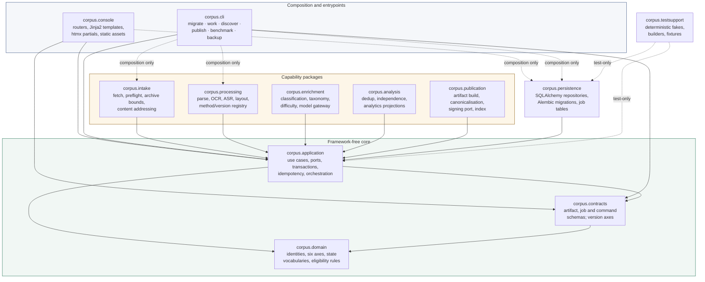
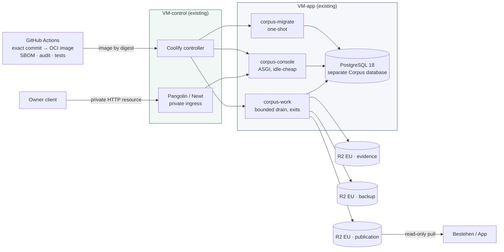

# Bestehen / Corpus — Stage 03: Technology Stack and Repository Strategy

- **Status:** Accepted architecture baseline
- **Date:** 2026-08-27
- **Owning stage:** Stage 03 of 28
- **Applies to:** Stages 05, 11–15, 19–26 and every later implementation plan, module boundary, migration, job, container, CI gate and operations surface
- **Durable operating decision:** [ADR-0001](adr/ADR-0001-offline-first-reuse-first-operating-model.md)
- **Durable boundary decision:** [ADR-0002](adr/ADR-0002-one-way-asynchronous-corpus-to-app-publication-boundary.md)
- **Durable stack decision:** [ADR-0003](adr/ADR-0003-python-first-modular-monolith-and-single-ecosystem-operations-console.md)
- **Implementation status:** architecture only; no production code, package, lockfile, migration, image, infrastructure, account, resource, key, deployment or provider call was created

## 1. Purpose, scope, and non-implementation boundary

Stage 01 fixed how decisions are judged. Stage 02 fixed where the system ends. Stage 03 fixes **what the system is built out of**: one primary language and runtime, one packaging and dependency workflow, one server/application architecture, one persistence and migration approach, one job mechanism, one operations-UI approach, one repository shape, and the deployment/dependency/observability constraints those choices impose on every later stage.

The decision criterion is **total owner cost**, defined by Stage 01 §7.2 and the reuse policy §4: implementation complexity, parser/OCR/ASR ecosystem quality, testability, package and security maintenance, container build/runtime cost, operational burden, recurring cash, paid-provider dependence, and exit. Maximum code reuse with Bestehen / App is explicitly **not** the criterion.

This stage deliberately does **not** select: physical tables, indexes or retention mechanics (Stage 05); crawler or robots implementation (Stage 06); sanitiser, SSRF or archive-bounding libraries (Stages 12, 23); the concrete OCR/ASR/layout/model libraries, thresholds or providers (Stages 13–15, 22); publication packaging, canonicalisation or signature algorithm (Stage 19); console information architecture, component inventory or authentication mechanism (Stages 20, 23); benchmark harness mechanics (Stage 21); alerting or cost-ledger implementation (Stage 24); test-matrix instantiation (Stage 25); or the final environment, release and recovery topology (Stage 26).

It provisions nothing. No account, project, environment, database, bucket, credential, image registry or deployment was created or modified.

Normative words follow Stage 01 §1: **MUST/MUST NOT** is a hard gate; **SHOULD** is the default requiring measured evidence to deviate; **MAY** is an allowed choice.

## 2. Inputs, source cuts, authority, and reconciliation

### 2.1 Repository source cuts

| Repository | Current main commit read | Role |
|---|---|---|
| m-elsharkawi/Bestehen-Shaping | f9a468ee63a4c4c778b1a535e13c419bb50cd703 | Read-only product truth; unchanged since Stage 02 |
| m-elsharkawi/Bestehen-Corpus | 996c8812b793ea99521f76d3927684504f30e7fb before Stage 03 writes | Architecture target; `Design/` read-only |
| m-elsharkawi/Bestehen-App | c39ec9c1ecb3a3dd2220ea28f7f71ecf88322cf8 | Read-only implementation/integration reference; unchanged since Stage 02 |

### 2.2 Mandatory input manifest

| Repository path | Blob SHA read | Use |
|---|---|---|
| Bestehen-Shaping/corpus/08-ingestion-and-extraction-pipeline.md | f705a970b6755758dc8025176be96c9991efe6ee | Thirteen-state lifecycle, partial failure, OCR/ASR/answer-linking rules, derivation records |
| Bestehen-Shaping/corpus/13-operations-and-review-experience.md | 67e271422075242dda311c8318252c3ef557063c | Minimum operations surface, governed actions, no-raw-row-editing rule, health vector |
| Bestehen-Shaping/corpus/14-cost-scale-and-automation.md | 63fd7e8b8d5239ca1883000c98d058000d5a91a2 | Envelopes, cheap-first ladder, retry/crawl/storage guardrails, cost targets, upgrade triggers |
| Bestehen-Shaping/corpus/15-security-privacy-and-abuse-boundaries.md | fee944281e46ecb48febd89dec269d5f302c2431 | Untrusted input, no active-content execution, secrets isolation, external-processing gate |
| Bestehen-Shaping/corpus/16-initial-corpus-benchmark.md | b596fe8349ee394fd92ce3ea1ef16ea0ff676770 | Regression layers, replay obligation, qualification gates the stack must be able to run |
| Bestehen-Shaping/corpus/17-bestehen-corpus-product-specification.md | 537b5185313097d043748f9dc9f9fdaf432ee71d | Consolidated authority; §7.3 intentionally open technology list |
| Bestehen-Corpus/Architecture/00-architecture-shaping-plan.md | 5c13d2f5d5f6b85c966508a97a9cded6c6f443d5 | Workflow, authority order, ADR and research rules |
| Bestehen-Corpus/Architecture/00-app-implementation-tooling-and-account-reuse-policy.md | d93c6084aa6b5603a86fdc080c1f70aa91ca2cc8 | Reuse order, Python-first-class clause, required assessment table |
| Bestehen-Corpus/Architecture/01-architecture-charter-and-quality-attributes.md | 500cc8f9644ed80c02fcce3f6fff94a3c25eab3b | Principles, quality scenarios, precedence, budgets, forbidden shortcuts |
| Bestehen-Corpus/Architecture/02-system-context-and-product-boundaries.md | 6ffeb3a8ed65ccd5be20ef760e48aaf0c38cdce1 | CTX-D01/D05/D07/D08, zones, paths, dependency inventory, §17.6 Stage 03 requirement |
| Bestehen-Corpus/Architecture/adr/README.md | d408cca711c6bd36841e7478444477c8d72e7325 | ADR criteria, template, index, next free number |
| Bestehen-Corpus/Architecture/adr/ADR-0001-… | ffd0970cf3ac27ace033fa7d674e9d0bc7cf6048 | Reuse-first operating model constraining this stage |
| Bestehen-Corpus/Architecture/adr/ADR-0002-… | 6a414334e2de418217207dde18e89a5793d5235c | One-way asynchronous publication boundary |
| Bestehen-Corpus/Bestehen_Corpus_Architecture_Checklist.md | 74d9b1607c2b3e12d97c8a66bcd60cf11eb3f5e2 | Complete Stage 03 section read before deciding |
| Bestehen-Corpus/Design/DESIGN-HANDOFF.md | fc573707efcf0c632384dfc1fd45ab6595b11369 | Twelve locked product-truth decisions, state contracts, responsive and accessibility rules |
| Bestehen-Corpus/Design/Corpus-02-Components.dc.html | 921e885434bbd715f334e1745eb0fdc92cf86a87 | 34 component contracts: table semantics, drawers, panes, focus, announcements |
| Bestehen-Corpus/Design/Corpus-06-Responsive.dc.html | 882e5ece14ba2070073a4851266adda8a54c7adc | Breakpoints, desktop-only justifications, read-only companion, 200% reflow |
| Bestehen-Corpus/Design/Corpus-09-Coverage-Handoff.dc.html | 29d57384aaa45c199baa400c09688d96eb4c9ff3 | 24 launch-required surfaces, 10 deferred items, load-bearing decisions |
| Bestehen-Corpus/prompts/architecture/03_decide_technology_stack_and_repository_strategy.txt | aeb7ceb73e1d58f3e9caee8fbf2a2d343bf008a0 | Current executable Stage 03 instructions |
| Bestehen-App/Implementation/Personal/02-provider-service-setup/handoff.md | f538df5be3ada4c26891e3f4a2ab1d800f244f24 | Accepted provider/runbook baseline; readiness caveats |
| Bestehen-App/Implementation/Personal/02-provider-service-setup/plan.md | 268b81ac9edd6a12b7f1d174d6c5b70085fb7aba | Guide contract, fake-first defaults, evidence receipt design |
| Bestehen-App/docs/setup/personal/README.md | 269542c44492bbd2b6df3492c1e7dea9312530b6 | Safe sequence, resource naming, least-privilege roles, custody templates |
| Bestehen-App/docs/setup/personal/01-github.md … 09-staging-readiness.md | read at current head | GitHub, Coolify two-VM, Pangolin, R2 EU, Auth0, SES, AI/STT/TTS, secrets, checkpoint mechanics |
| Bestehen-App/.env.example | ad6187c9c64a6d8eea1845e449f2a3f766d22a28 | Configured-group and fake-first configuration conventions (context only) |
| Bestehen-App/README.md | f7881a5ac88cb5212ec61b9697b54763eca539f7 | Local development contract and gate naming (context only) |
| Bestehen-App/Architecture/03-technology-stack-and-repository-strategy.md | 907b04c57813dc50f92a7ed00e49196ff7d4a924 | Counterpart stack reasoning (context only, not authority) |
| Bestehen-App/Architecture/26-environments-ci-cd-release-and-operations.md | c81412c46aa3b2a77ac9fcb4a0840e1b63af8bd4 | Counterpart environment/release posture (context only, not authority) |

The current Corpus repository tree was inspected before recommending modules: it contains `Architecture/`, `Architecture/adr/`, `Design/`, `prompts/architecture/` and the checklist. **No implementation source, package manifest, lockfile, container file or CI workflow exists yet.** Stage 03 therefore defines the shape those artifacts must take; it creates none of them.

### 2.3 Authority order applied

Corpus Stage 17, then delegated Corpus stages, then umbrella overview and identity, then Corpus design, then the App counterpart. Corpus Stage 17 §7.3 lists database, storage, API transport, queue, crawler, parser/OCR/ASR runtimes, admin UI technology, deployment topology, cache, analytics engine, telemetry and CI mechanism as **intentionally open architecture decisions**, so Stage 03 is deciding, not reopening. Design expresses observable outcomes and is not a runtime mandate (Stage 01 P12).

### 2.4 Reconciliation of current state

Four differences required explicit reconciliation. None is an owner blocker.

1. **The App counterpart names two different hosting realities.** `Bestehen-App/Architecture/03` and `/26` select Render Frankfurt web, worker and managed PostgreSQL; the App personal implementation runbooks (`docs/setup/personal/02-coolify-two-vm.md`, `03-pangolin-…`) and the accepted Stage 02 provider handoff instead operate the existing **two-VM Coolify controller/deployment boundary with Pangolin/Newt private ingress**, deploying `Dockerfile.web` and `Dockerfile.worker` as OCI images. For Corpus, `Architecture/00-app-implementation-tooling-and-account-reuse-policy.md` §2 and Stage 02 CTX-D07 name Coolify/Pangolin as the reuse baseline, and App architecture cannot define Corpus semantics. **Corpus reuses the Coolify/Pangolin/OCI reality.** App Architecture 03/26 remain context only.
2. **App Architecture 03 deferred OCI packaging; the App implementation adopted it anyway.** The implementation ships two Dockerfiles and a mandatory `OCI non-root read-only health and signal` CI job. Corpus takes the implementation reality as its baseline, which is also what CTX-D07 requires. This removes any argument that container packaging is a Corpus-specific new burden.
3. **Corpus Stage 13 §3.1 permits an off-the-shelf admin or low-code tool as an implementation direction, but Stage 13 §1.2, §3.4, §3.5 and §5.10 forbid raw-row editing as the normal workflow and require governed actions, override precedence, append-only audit, rights/takedown semantics and scoped reprocessing.** Reconciled: a generic database/admin console cannot represent those semantics, and a hosted low-code product would additionally be a new vendor under ADR-0001. Corpus therefore builds a small owned console (§7) rather than adopting an admin tool. Stage 13's fallback remains available only for a tool that can enforce the governed-action contract, which none is claimed to do.
4. **Design shows the benchmark as not instantiated and every capability as `not qualified`.** Unchanged from Stages 01–02. No stack claim in this artifact asserts a qualified OCR, ASR, layout or model capability; §5 evaluates **ecosystem availability and licence posture only**, and every capability claim remains a Stage 21 obligation.

## 3. Stage 03 decision register and traceability

| ID | Decision | Principal alternative rejected | Governing source | Downstream owners |
|---|---|---|---|---|
| STK-D01 | **One primary runtime: the Python 3.14 line**, pinned to an exact patch, with `uv` as the single environment/dependency/lockfile workflow. No Node runtime is added for symmetry. | TypeScript-first on Node 24 LTS; hybrid with a bounded second-language processor | Reuse policy §4, Stage 08 §4.5–4.6, Stage 14 §3.3, Architecture 01 P6/P7 | 05, 11–15, 20–26; **ADR-0003** |
| STK-D02 | **Modular monolith**: one Python distribution, one OCI image, three process entrypoints — owner console, bounded batch worker, one-shot migrator. No service-per-domain. | Microservice or per-pipeline-stage deployables | Architecture 01 P7, CTX-D01, Stage 17 §7.3 | 11, 20, 26 |
| STK-D03 | HTTP layer is a **thin ASGI façade** (Starlette via FastAPI) that translates transport to application use cases. `corpus.domain` and `corpus.application` import no web framework, no ORM and no provider SDK. | Framework-centric application where the web framework owns models and the batch worker must import it | Architecture 01 P1/P7, App package-boundary precedent | 04, 05, 11, 20, 25 |
| STK-D04 | Operations console is **server-rendered semantic HTML** (Jinja2) with htmx partial swaps and hand-written progressive-enhancement JavaScript. No SPA, no second frontend ecosystem, no design-runtime reuse. | Next.js/React reuse from App; a JavaScript admin framework | Design handoff §6–§8, Stage 13 §3.1, Architecture 01 P12 | 20, 25; **ADR-0003** |
| STK-D05 | **PostgreSQL 18 reuse** with SQLAlchemy 2.0 as a thin typed SQL layer, hand-reviewed forward-only Alembic migrations and psycopg 3. Separate Corpus database and per-consumer roles. | Django ORM with autogenerated migrations; a generated-client ORM; SQLite | Reuse policy §2, CTX-D07, App `ARCH-S03-D02` posture | 05, 11, 18, 26 |
| STK-D06 | **Jobs are application-owned PostgreSQL tables** claimed with `FOR UPDATE SKIP LOCKED`, drained by a bounded worker that exits. No Redis, no managed queue, no pg-boss re-creation. | Redis/managed queue; an always-on autoscaling worker fleet | Reuse policy §2/§5, CTX-D08, Stage 14 §4.9 | 11, 24, 26 |
| STK-D07 | **Object storage reuses the existing Cloudflare R2 EU account** through a narrow S3-compatible port, with three separate Corpus buckets and three separate credentials (evidence, publication, backup). | One shared bucket; a new storage vendor; local disk as the durable store | CTX-D07, ADR-0002, App `R2-01`–`R2-07` | 05, 19, 23, 26 |
| STK-D08 | **Deployment is OCI-only on the existing Coolify boundary** behind Pangolin private ingress, built in GitHub Actions from an exact commit and pinned base-image digest. Worker execution shape is chosen from candidates W1–W3 in Stage 26 after capacity measurement. | A second host, control plane or PaaS subscription; host-level cron outside the control plane | CTX-D07, ADR-0001, Stage 14 §4.16 B | 26 |
| STK-D09 | **No identity provider and no email at launch.** Access is Pangolin private ingress plus a Corpus-owned authorisation check and CSRF control. Recommended default recorded; the decision belongs to Stages 20/23. | Adding Auth0 EU and AWS SES because App has them | Stage 02 §11.1, Stage 15 §4.5, reuse policy §3 | 20, 23 |
| STK-D10 | **AI/media provider families are constrained to the existing Gemini and OpenAI account relationships**, reached through one model-gateway port, after local/deterministic work fails its gate. Polly stays `not_admitted`; Corpus synthesises no speech. | Selecting a managed document-AI or ASR platform at Stage 03 | Reuse policy §2, CTX-D09, Stage 14 §3.4 | 13–15, 22 |
| STK-D11 | **One private repository, one uv project, one lockfile**, internal module boundaries enforced by an import-contract check in CI. No build orchestrator. | Polyrepo; multi-package workspace; Nx/Turbo-class orchestrator | Reuse policy §5, App `ARCH-S03-D06` precedent | every implementation stage |
| STK-D12 | **Dependency, licence, native-tool and container policy** (§12): frozen lockfile, permissive-licence allowlist, recorded exception for AGPL tools, pinned system packages and checksummed model artifacts, SBOM and critical-severity audit gate, non-root read-only container. | Floating ranges; unpinned system packages; runtime model downloads | Stage 15 §4.5, Architecture 01 §12, App `GH-03`/`SEC-02` | 12–15, 22, 23, 25, 26 |
| STK-D13 | **Local development and CI use Docker Compose PostgreSQL and deterministic fakes.** No live paid provider is required for normal local or CI runs. | Requiring live provider credentials for development | Stage 02 §11.2, App fake-adapter precedent | 21, 22, 25 |
| STK-D14 | **Observability starts with structured JSON logs to stdout, two health routes and PostgreSQL run/job/cost records.** No APM, log or analytics SaaS at Stage 03. | Adding a managed telemetry sink now | Reuse policy §2, Stage 02 §9, Stage 13 §4.10 | 24, 26 |

## 4. The workload this stack must actually serve

The stack is chosen against the measured shape of Corpus work, not against general web-application preferences.

| Workload | Source of the requirement | What it demands of the stack |
|---|---|---|
| PDF, DOC/DOCX, HTML, image, archive and audio intake with bounded expansion and inert handling | Stage 17 §1.4, Stage 15 §3.3–§3.5 | Mature, permissively licensed local format libraries; the ability to run parsing in a process that holds no broad credentials |
| Page/region-selective OCR with layout preservation and page lineage | Stage 08 §4.5, Stage 14 §4.3 | A local OCR engine with region-level output (hOCR/ALTO/TSV), not a whole-document black box |
| Selective ASR with coarse-to-fine alignment and answer-critical token scrutiny | Stage 08 §4.6, Stage 14 §4.4 | A local ASR path with word/segment timestamps, runnable on CPU |
| Deterministic structure, fingerprinting, dedup and analytics over 20k–50k canonical Items | Stage 14 §3.1, Stage 17 §4.8, §4.10 | Strong SQL and data-processing ergonomics; no distributed engine |
| Batch, resumable, replayable runs with immutable observations and append-only audit | Stage 08 §4.2/§4.10, Architecture 01 P2/P4 | Explicit SQL, hand-reviewed migrations, idempotent job claims |
| Cheap-first ladder with paid escalation as a bounded exception | Stage 14 §3.3, Architecture 01 P6 | Local capability must be genuinely good enough to be the default |
| Rights-blocked external processing | Stage 15 §4.3, Stage 08 §5.16 | A **local** processing route is a rights requirement, not only a cost preference |
| Dense, accessible, owner-only console: 41 surfaces, 34 components, WCAG 2.2 AA | Design handoff §6–§8 | Semantic HTML, focus and announcement control, no indefinite spinner, table alternatives for charts |
| No always-on process required by any product promise | CTX-D08, Stage 02 §17.6 | A runtime that runs equally well as a short-lived batch command |

Two consequences dominate the language decision. First, **Corpus is a document/media processing product with a small internal UI**, not a web application with incidental file handling. Second, **the local processing path is load-bearing for rights and cost**, so an ecosystem that pushes OCR/ASR toward paid providers fails a hard gate rather than merely costing more.

## 5. Language and runtime comparison

### 5.1 Current official evidence used

Facts and their sources are listed with access dates in §17.1. Scores below are architecture judgement informed by those facts, not vendor benchmarks.

### 5.2 Decision matrix

Each criterion is scored 1 (poor) to 5 (strong), equally weighted, out of 50. Stage 01 §8.1 precedence acts as a **veto** that arithmetic cannot override; a vetoed option is rejected regardless of its total.

| Option | Processing ecosystem | Semantic/type safety | Security & reproducibility | Container/Coolify fit | UI accessibility & maintainability | Operational simplicity | Recurring/variable cost | Paid-provider dependence | Portability/exit | Owner maintenance time | Total /50 | Verdict |
|---|--:|--:|--:|--:|--:|--:|--:|--:|--:|--:|--:|---|
| **A. Python-first on existing Coolify / PostgreSQL / R2 / provider accounts** | 5 | 4 | 4 | 5 | 4 | 5 | 5 | 5 | 5 | 4 | **46** | **Selected** |
| B. TypeScript-first on the same infrastructure | 2 | 5 | 4 | 5 | 4 | 4 | 3 | 2 | 4 | 4 | 37 | Rejected; fails the rights/cost veto below |
| C. Hybrid — Python processor plus a TypeScript console | 5 | 5 | 3 | 4 | 5 | 2 | 4 | 5 | 4 | 2 | 39 | Rejected now; reopen only on a measured console failure |
| D. New platform — managed document-AI and serverless runtime | 4 | 3 | 3 | 2 | 3 | 3 | 1 | 1 | 1 | 3 | 24 | Rejected; new vendor without a measured blocker |
| E. No extra service — owner-workstation scripts, no deployed console | 5 | 3 | 2 | 1 | 1 | 3 | 5 | 5 | 4 | 1 | 30 | Rejected as the launch shape; retained as the degraded fallback |

### 5.3 Why Python-first wins

**The processing ecosystem gap is real and one-directional.** Python offers a mature, permissively licensed, locally runnable toolchain across every Corpus modality: PDF rendering and text/object extraction (pypdfium2, Apache-2.0 or BSD-3-Clause over Google's BSD-licensed PDFium), OCR with region-level output (Tesseract 5, Apache-2.0, with hOCR/ALTO/TSV/PDF outputs and German models, wrapped by OCRmyPDF for page-selective scanned-PDF work), and CPU-capable ASR with word-level timestamps (faster-whisper, MIT, over CTranslate2; whisper.cpp, MIT, as a second local route). The Node ecosystem's nearest equivalents are materially weaker for this workload: PDF.js is documented by Mozilla as a platform for *parsing and rendering* PDFs, not structured extraction, and tesseract.js states in its own documentation that it **does not support PDF files** and **does not modify the recognition model**, recommending a different project for those needs.

**That gap converts into a hard-gate failure, not a preference.** A TypeScript-first Corpus can only close it by (a) shelling out to the same C/C++/Python binaries, which reintroduces the second ecosystem it was meant to avoid while losing typed integration and in-process error handling, or (b) routing OCR and ASR to paid providers by default. Option (b) breaks four governing rules at once: Stage 15 §4.3 and Stage 08 §5.16 require a **local** route when rights do not permit raw source expression to leave the boundary; Architecture 01 P6 makes cheap deterministic/local work the first tier; Stage 14 §4.1 budgets ≤10% stronger-model escalation at mature base scale; and QA-CST-01 caps paid variable processing at ≤€3 per 1,000 canonical Items. Under Stage 01 §8.1 the rights and correctness tiers outrank convenience, so option B is vetoed independently of its arithmetic total.

**Code reuse with App was never available.** ADR-0002 makes the Corpus → App boundary a one-way publication of immutable artifacts, not a shared library. App's packages own learner identity, coaching, Readiness and a learner-facing design system; Corpus's own logic is source provenance, rights, extraction, dedup and capability eligibility. There is no module either product could import from the other. Sharing a language would have shared **tooling habits**, not code — and those habits (frozen lockfile, pinned toolchain, fake-first adapters, non-root read-only images, named CI gates) transfer to Python unchanged (§12–§13).

**The honest cost of Python-first** is that the owner maintains two language ecosystems across the two products: two dependency-update routines, two CI toolchains, two sets of security advisories. That is a genuine recurring burden and it is priced in §15. It is accepted because everything *operationally* expensive stays shared — one control plane, one ingress model, one relational technology, one object-storage account, one secret-custody practice, one CI system — and because the alternative moves the burden into a place where it costs money and rights safety instead of attention.

### 5.4 Why the hybrid and the new platform were rejected

The hybrid would be justified only if the console genuinely required a JavaScript component framework. It does not: the design contract is dense semantic tables, drawers, split panes, focus management, live-region announcements and inline SVG charts with table alternatives (§7). A second runtime for that would add a second lockfile, a second advisory feed, a second build, a second container layer and a second failure mode, for a UI that one person uses. **Reopen only if** Stage 20 demonstrates a launch-required interaction that server-rendered HTML plus bounded scripting cannot make accessible, or Stage 25 records repeated accessibility regressions attributable to the approach.

The new-platform option is shown to prove it is unjustified rather than to short-list it. A managed document-AI plus serverless runtime would add a new vendor, a new billing relationship, per-page pricing on the exact operation Corpus intends to do locally, an availability dependency where CTX-D08 has deliberately removed one, and a weaker exit than portable files and SQL. ADR-0001 requires a measured Corpus-specific blocker before a new vendor; none exists.

Option E — no deployed service at all — is not viable as the launch shape because Stage 13 requires a governed operations surface with audit, override precedence and safe actions, which owner-workstation scripts cannot enforce. It survives as the **cheapest degraded fallback** (§15).

## 6. Selected stack

### 6.1 Runtime and packaging — STK-D01

The **Python 3.14 line**, pinned to an exact patch at implementation start and expressed as `requires-python = ">=3.14,<3.15"` plus a `.python-version` pin. Python 3.14 was released 2025-10-07, is in the bugfix phase and has a scheduled end of life in 2030-10, which gives roughly four years of upstream support from now. Python 3.15 is scheduled for 2026-10-01; Corpus MUST NOT move to it until the OCR/ASR and native-wheel toolchain publishes 3.15 wheels and the Stage 21 benchmark passes on the new line.

**`uv` is the single environment, dependency, lockfile and Python-version workflow.** It is MIT-or-Apache-2.0 licensed, installs and manages Python versions, and produces a universal lockfile; `uv sync --locked` fails when the lockfile is stale and `--frozen` skips revalidation. That is the direct analogue of the App CI's `pnpm install --frozen-lockfile` gate, so the reproducibility contract is identical across both products. uv is pre-1.0 (0.12.6 at access); the mitigation is that its outputs — `pyproject.toml`, a lockfile and a standard virtual environment — are portable, so a fallback to `pip` plus a compiled requirements file is a configuration change, not a rewrite.

No Node runtime is installed in the Corpus image. Front-end assets are hand-authored CSS and JavaScript served as static files (§7); there is no bundler, transpiler or npm dependency tree.

### 6.2 Backend and control plane — STK-D02, STK-D03

One modular monolith, three entrypoints, one image:

- **`corpus-console`** — the ASGI application (FastAPI over Starlette, MIT, Pydantic v2 for boundary validation) served by an ASGI server. It renders the owner console and accepts governed commands. It has no background loop and no scheduler.
- **`corpus-work`** — a command that claims and executes queued work, reports progress, and **exits** when the queue drains or a bounded budget is reached. This is the entire batch surface: discovery, intake, processing, enrichment, analysis, publication build, backup and benchmark replay are subcommands, not services.
- **`corpus-migrate`** — a one-shot migration runner executed explicitly before a compatible console/worker activation, mirroring the App `OPS-04` rule that neither web nor worker startup owns migrations.

FastAPI is still versioned 0.x (0.141.1 at access, MIT, Python ≥3.10). That is accepted because the HTTP layer is deliberately thin — routers translate to use cases and own no domain rule — so it is replaceable; because the surface is owner-only behind private ingress, which bounds the blast radius of a framework defect; and because the alternative with the stronger support policy was evaluated and rejected on other grounds below. Exact versions are pinned and the framework is treated as a Stage 25 upgrade-gated dependency.

**Django was the strongest rejected alternative** and deserves its reasons stated. Django 5.2 LTS carries extended support to April 2028 and would supply ORM, migrations, forms, sessions, CSRF and templates in one dependency — a real reduction in assembly work for a solo owner. It is rejected because its three largest wins do not apply here: the admin is explicitly not an acceptable operations surface under Stage 13 §5.10, its auth/session layer is not needed at launch under STK-D09, and its ORM-shaped modelling with autogenerated migrations works against the explicit DDL, check constraints, partial indexes and append-only semantics the six-axis evidence model needs (§6.3). A fourth reason is structural: touching Django models requires `django.setup()` and a settings module, so every batch command would import a web framework — the coupling STK-D03 exists to prevent. The cost of not choosing Django is that CSRF, session handling and form binding become explicit, owned code; §7 and §17.4 record that as a named obligation and a residual risk rather than pretending it is free.

### 6.3 Persistence and migrations — STK-D05

PostgreSQL is reused as technology, infrastructure and account (CTX-D07). Corpus gets its **own database** on the existing instance — not a schema inside the App database — with three roles mirroring the App least-privilege pattern: a migrator role holding DDL, a console role and a worker role holding only the DML each needs. Corpus MUST NOT be granted access to App learner tables, and no credential is shared between products.

The access layer is **SQLAlchemy 2.0 (MIT)** used primarily through Core and typed ORM constructs, with **psycopg 3 (LGPL-3.0-only)** as the driver and **Alembic** for migrations. The rule is the same one the App accepted for Kysely: *SQL stays visible and reviewable, and there is no generated ORM client*. Migrations are hand-reviewed, forward-only, expand/contract, and applied to an empty database in CI. psycopg's LGPL-3.0 licence is recorded and accepted because Corpus is a self-operated service that distributes no binary; the obligation is noted in §12 rather than assumed away.

Stage 05 owns tables, indexes, constraints, retention fields and evolution. Stage 03 fixes only the engine, the access posture and the isolation boundary.

### 6.4 Jobs and orchestration — STK-D06

Durable work lives in **application-owned PostgreSQL tables**: a run table (scope, cause, governing versions, outcome) and a job table (idempotency key, state, attempt count, claim expiry, last failure class). Workers claim with `SELECT … FOR UPDATE SKIP LOCKED`, which PostgreSQL documents as intended for exactly this case — *"can be used to avoid lock contention with multiple consumers accessing a queue-like table"* — while also documenting that it gives an inconsistent view and is unsuitable for general-purpose work. Claims are therefore confined to the queue table and never used for evidence reads.

Rules this mechanism must satisfy, all from product truth: bounded retries by failure class (Stage 14 §4.9); negative caching of unchanged deterministic failures; dependency-scoped reprocessing from the earliest affected stage; partial success committed per independently valid unit; and every job attributable to a run, a scope and its governing method/model/rule/taxonomy versions.

No Redis, broker or managed queue is introduced. A PostgreSQL-backed Python job library — Procrastinate (MIT, PostgreSQL 13+, no separate broker) is the leading example — is a **permitted later substitution behind the same job port** if the owned table demonstrably costs more to maintain than it saves. That substitution needs no ADR because it changes no boundary; adding a broker or a second store does.

## 7. Operations UI architecture — STK-D04

### 7.1 What the design actually requires

Design page 09 lists 24 launch-required surfaces; page 02 documents 34 components; page 06 fixes five breakpoints, three desktop-only surfaces and a `<900` read-only companion. The demanding parts are: real table semantics with `th scope`, `aria-sort` and hover-free row actions; drawers with focus traps and trigger-restoring focus; keyboard-resizable split panes; roving-tabindex tabs; a persisted queue context object (filters, sort, density, page, scroll offset, focused row) restored after a detail visit, a reload and a session expiry; rationale drafts that survive navigation, reload, **network loss** and session expiry; a background job tray that announces politely and never steals focus; no indefinite spinner anywhere; inert non-focusable sanitised previews; and charts that are preceded by a finding sentence and followed by a real table, with no pie, donut or gauge.

### 7.2 The chosen approach

Server-rendered HTML from Jinja2 templates (FastAPI documents Jinja2 templating and static-file serving as first-class), with **htmx** for partial swaps and a small amount of hand-written JavaScript for the four behaviours that genuinely need client state: focus management after a swap, live-region announcements, the queue context object, and draft persistence across network loss. htmx is dependency-free, ships as one script tag, responds with HTML rather than JSON, and degrades gracefully where `hx-boost` wraps ordinary links and forms.

This is chosen because it minimises ecosystems, not because HTML is fashionable. Dense evidence tables, letter-coded eligibility matrices, audit timelines and diff panes are text and structure; a component framework would add a build pipeline, a second lockfile and a hydration model without making any of the 24 launch surfaces easier to render correctly. It also removes a whole class of accessibility regressions: with server-rendered markup the reading and tab order *is* the DOM order, which is exactly what the design's focus contract assumes.

### 7.3 Obligations this approach creates

| Requirement | Obligation on the implementation | Owning stage |
|---|---|---|
| Focus contract across partial swaps | Every htmx swap MUST declare its focus outcome explicitly; swapping is not allowed to leave focus on a removed node | 20, 25 |
| Announcements | One polite live region for progress/counts/completion/staleness/partial success; one assertive region reserved for security holds and session expiry; nothing announced twice | 20, 25 |
| Queue context object | Saved views and their filters/sort/density persist server-side in PostgreSQL; scroll offset and focused row persist per-browser | 20 |
| Draft survival through network loss | Rationale drafts written to browser storage on input and reconciled with a server-side draft record on reconnect; drafts listed in the header until submitted or deliberately discarded | 20, 23 |
| No indefinite spinner | Anything slower than a few seconds becomes a job; the tray polls a status partial; first progress/heartbeat within QA-PERF-01's 60 s | 11, 20, 24 |
| Charts | Rendered as inline SVG from Python with a preceding finding sentence and a following table; no charting SaaS and no heavy client chart library | 20 |
| Fonts and icons | IBM Plex Sans/Mono (SIL OFL 1.1) and the Lucide subset (ISC) are **self-hosted** and inlined; no CDN or remote font, because Z5 must not load remote assets | 20, 23 |
| CSRF and session integrity | Explicit, owned CSRF protection on every state-changing request, independent of Pangolin ingress authorisation | 20, 23 |
| Design artifacts | `Design/*.dc.html` and `Design/support.js` remain read-only reference inputs and are never imported, copied as configuration, or treated as production source | 20, 25 |

htmx is a third-party client dependency and is replaceable: pages MUST remain usable as plain forms and links wherever practical, so removing htmx degrades interaction quality rather than breaking a governed action.

## 8. Module and repository structure — STK-D11

One private repository (`m-elsharkawi/Bestehen-Corpus`, already holding `Architecture/`, `Design/` and `prompts/`), one uv project, one lockfile, one distribution. Modules are Python packages inside that distribution, not separately published artifacts.

Rules, enforced by an **import-contract check in CI** (import-linter, BSD-2-Clause, is the named candidate) rather than by the diagram:

- `corpus.domain` imports no other Corpus package and no third-party framework, ORM, HTTP client, provider SDK, clock or random source.
- `corpus.application` may import `domain` and `contracts` only. It defines **ports**; it never imports a concrete adapter.
- Capability packages and `persistence` implement ports and are injected at a composition root inside `console` or `cli`.
- `corpus.intake` is kept separate specifically because it handles Z0 → Z1 material and must run with the narrowest credentials; no capability package may import it to reach the network.
- There is no `shared`, `common` or `utils` package. A new package needs a named responsibility, a permitted dependency direction and either two real consumers or an isolation reason.
- Large source bytes, media, model artifacts, local databases, build output and secrets are never in Git history; manifests, digests, small synthetic fixtures and rights metadata are.

No build orchestrator is added. If a measured need appears — a clean CI run whose median exceeds ten minutes, or more than 30% redundant work — the first response is caching and lane splitting, not a new tool.

## 9. Deployment on the existing Coolify and Pangolin boundary — STK-D08

### 9.1 Candidate topology

### 9.2 Worker execution candidates

Coolify's built-in scheduled tasks are container-scoped and run a command inside an existing application container, and Coolify documents standard cron syntax plus predefined schedule strings. That mechanism detail is an **operational assumption to confirm in Stage 26**, so the candidates below are designed so that CTX-D08 holds regardless of which is chosen.

| ID | Shape | Always-on process? | Fits CTX-D08 because | Cost | Chosen when |
|---|---|---|---|---|---|
| W1 | Console container runs continuously and idle-cheap; a Coolify scheduled task execs `corpus-work` inside it on a cadence | Only the console, which no product promise depends on | If the console is stopped, App still reads the published artifacts; nothing downstream degrades | No new resource | Default candidate; existing VM headroom suffices |
| W2 | Separate worker container that drains, sleeps and drains again | One modest worker | Same reason; the worker can be stopped indefinitely and work becomes backlog, a normal deferred state | No new resource; second container's idle footprint | Media-heavy batches need isolation from console memory |
| W3 | Owner-triggered runs only, launched from the console | None | Fully on demand | No new resource | Very low volume, or during early bootstrap |
| W4 | Host cron or systemd timer on VM-app invoking `docker run --rm` | None | Same | No new resource | **Rejected now**: it operates outside the Coolify control plane and creates a second operations surface |

Ingress: one Pangolin private HTTP resource for the console, owner-grant only, mirroring the App `NET-03` pattern. The worker, the migrator and PostgreSQL are never routed through Pangolin and never publicly exposed. There is **no public Corpus surface of any kind**.

Health: `/health/live` MUST NOT query PostgreSQL; `/health/ready` MUST fail closed when its dependency is unavailable — the App `OPS-04` rule, reused verbatim.

Container contract: multi-stage build; a base stage installs pinned system packages (OCR engine and language data, media tooling) so it caches independently of application layers; the final image runs **non-root with a read-only root filesystem**, mirroring the App's mandatory `OCI non-root read-only health and signal` gate. Base images are pinned by digest, never by mutable tag.

## 10. Object storage, publication and resource isolation — STK-D07

| Resource | Convention | Isolation rule |
|---|---|---|
| Corpus database | Separate database on the existing PostgreSQL instance | Three roles: migrator (DDL only), console, worker. No access to App tables. Distinct connection URLs per consumer, mirroring App's per-resource `…_DATABASE_URL` pattern |
| Evidence bucket | R2, same Cloudflare account, jurisdiction `eu` chosen at creation | Raw source bytes and derived assets. Runtime credential is read/write on this bucket only |
| Publication bucket | R2, same account, jurisdiction `eu` | Only capability-eligible artifacts and the publication index. App holds a **read-only** credential scoped to this bucket/prefix and nothing else (Stage 02 proof B4) |
| Backup bucket | R2, same account, jurisdiction `eu` | Encrypted archives. Upload-only credential; decryption key held offline; console and worker have no read access |
| Model artifacts | Checksummed, versioned; baked into the image or fetched from the evidence bucket by digest | Never fetched at runtime from an unpinned third-party URL. The artifact digest is part of the recorded method version |
| Provider projects/keys | Separate Corpus Gemini project/key and separate Corpus OpenAI STT key inside the existing account families | Least privilege and separate cost attribution. Never an App key |

R2 jurisdiction is **immutable after bucket creation** (Stage 02 §17.1 research), so the three buckets are created deliberately in Stage 26 and never converted. Access uses only the portable S3-compatible subset behind a narrow port, so the store can be replaced by copying objects and repointing configuration. Object keys are opaque digests; they never encode a source name, owner identity or private address.

## 11. App implementation and account-reuse assessment

Status vocabulary follows the App runbook. **No row may claim `verified`**, because the App personal implementation checklist line covering provider verification remains unchecked and the Stage 02 handoff records repository acceptance rather than live readiness.

| Need / capability | Existing App tool/account and repository-safe status | No-service / local option | Reuse relationship? | Separate Corpus resource/credential? | Measured blocker or gate | Incremental recurring + variable + owner cost | Failure/degradation and exit | Decision / reason |
|---|---|---|---|---|---|---|---|---|
| Primary language/runtime | Node.js 24 LTS + TypeScript + pnpm; `owner_pending` for deployment, `verified` only as repository fact | — | **No — Python 3.14 selected** | Not applicable; this is not a vendor or account | Local OCR/ASR ecosystem quality and the rights requirement for a local route | Second dependency-update routine and advisory feed; zero cash | Portable Python, SQL and files; the boundary to App is artifacts, not code | Reuse policy §4 makes Python a first-class option and not a deviation |
| Source control and CI | GitHub + GitHub Actions; `owner_pending` for live billing/capacity | Local-only development | **Yes** | Separate repository exists; no shared secret | Private-repo minute allowance (Free 2,000 / Pro 3,000 per month at access) versus container builds carrying OCR/media system packages | Runner minutes from the existing plan; no new subscription | Releases pause; code and artifacts are portable | Reuse. A second CI SaaS remains forbidden |
| Deployment control plane | Existing two-VM Coolify boundary; `owner_pending` | Run nothing continuously (candidate W3) | **Yes** | Separate Corpus project/environment; no shared deploy credential | VM headroom for OCR/ASR batches is unmeasured | No new host fee if headroom suffices; shared patching time | Deploys pause; images are portable OCI | Reuse; Stage 26 measures headroom before committing |
| Private ingress | Pangolin/Newt; `owner_pending` | Owner-local access only | **Yes** | Separate private Corpus resource and owner grant | None | None beyond existing | Console unreachable; batch work and publication continue | Reuse. No public admin surface |
| Container runtime | Docker/OCI on existing VMs; `owner_pending` | — | **Yes** | Separate Corpus image and service identity | Image size and build time with OCR/media system packages | Layer caching effort; storage on the registry/host | Standard OCI; portable to any host | Reuse |
| Relational persistence | PostgreSQL 18 technology and infrastructure (App uses Kysely); `owner_pending` | SQLite-class local store | **Yes — technology and infrastructure** | **Yes**: separate Corpus database and three roles | Corpus write/analytics profile unmeasured | Shared instance cost; separate backup volume | `pg_dump` logical export | Reuse infrastructure, isolate data. Access layer is SQLAlchemy, not Kysely (STK-D05) |
| Durable jobs | pg-boss on PostgreSQL in App | Cron-driven drain in the same database | **Yes — the PostgreSQL-backed semantics** | Separate Corpus job tables and role | None | None beyond the database | Queue state is inspectable SQL | Reuse the pattern, not the library. No Redis or managed queue (STK-D06) |
| Object storage | Cloudflare R2 EU, S3-compatible; `owner_pending` | Local disk for a small corpus | **Yes — account and billing relationship** | **Yes**: three buckets, three credentials | 50–150 GB base storage envelope | Storage and operation classes; see §15 | S3-compatible copy-out; jurisdiction fixed at creation | Reuse account, isolate resources |
| Publication channel | App counterpart expects a private object channel plus a signed index | Manual file drop, rejected as unauditable | **Yes — same account family** | **Yes**: publication-only bucket, read-only consumer credential | None | Dominated by artifact bytes | Portable immutable files and digests | Reuse; mechanics belong to Stage 19 |
| Owner identity | Auth0 EU Passwordless Email OTP; `owner_pending` | Private ingress plus an owned authorisation check | **Account family available** | Separate Corpus application only if adopted | Whether ingress alone satisfies Stage 15's internal-only control | Zero if unused | Ingress-only fallback | **No service by default** (STK-D09); Stages 20/23 decide |
| Email | AWS SES Frankfurt; `owner_pending` | None needed | Account family available | — | No Corpus recipient exists; design defers notification channels | Zero | — | **No service** |
| General model | Gemini via existing Google AI account; `owner_pending` | Local/deterministic classification | **Account family** | **Yes**: separate project/key | Benchmark evidence that deterministic work is insufficient | Variable, inside the €3/1,000-Item target | Corpus-owned prompts and schemas | Reuse when escalation is justified (STK-D10) |
| STT / ASR | OpenAI STT via existing account; `owner_pending` | **Local ASR is the default** (CPU-capable, MIT-licensed) | **Account family** | **Yes**: separate key | Listening coverage need and benchmark quality | Variable, per audio minute | Fixture replay; provider replaceable | Reuse only for benchmark-qualified gaps |
| TTS / Polly | Exists for App / `not_admitted` | — | — | — | Corpus synthesises no speech | Zero | — | **No service**; Polly remains not admitted |
| Secret custody | Existing protected-ledger and least-privilege conventions | — | **Yes** | **Yes**: distinct Corpus values, never shared credentials | None | Owner time only | Rotation/revocation runbook pattern | Reuse conventions, never values |
| Observability | Platform, CI, VM and provider signals plus structured logs | Logs and health routes only | **Yes** | Corpus-scoped log and health surfaces | Stage 24 must prove a gap before buying anything | Zero | — | **No new SaaS** (STK-D14) |
| Backup | Encrypted archive to object storage, protected key custody | — | **Yes** | **Yes**: backup bucket, upload-only credential | Restore drill not yet run for Corpus | Storage only | Portable encrypted archive | Reuse pattern |

**Selecting Python is not a vendor or account deviation.** Every provider, account, control plane, network boundary and billing relationship in this table is reused, and every deviation from a shared *resource* is a least-privilege isolation inside the same account. **This assessment authorises nothing**: no bucket, database, role, project, key, image, environment or deployment may be created on the basis of this stage.

## 12. Dependency, licence, native-tool and supply-chain policy — STK-D12

- **Pinning and reproducibility.** One committed lockfile; CI and image builds use `uv sync --locked` (the App's frozen-install contract in Python form). The Python patch version is pinned in the repository and in the image. A lockfile change is reviewed as code.
- **Admission.** A runtime dependency needs a named capability, maintained upstream, a compatible licence, an acceptable transitive and native-build footprint, no unexplained install-time execution, and lower whole-life cost than a small owned implementation. Provider SDKs exist only in adapter packages, never in `domain`, `contracts` or `application`.
- **Licence policy.** Permissive licences (MIT, BSD, Apache-2.0, PSF, ISC, SIL OFL for fonts) are the default allowlist. **LGPL** is acceptable for a self-operated, non-distributed service and is recorded per dependency; psycopg 3 (LGPL-3.0-only) is the known instance. **AGPL requires an explicit recorded decision before use**: Ghostscript, which OCRmyPDF names as an AGPLv3 dependency for some paths, and PyMuPDF are the realistic cases. The default is to avoid them and prefer the Apache-2.0/BSD-licensed PDFium binding for rasterisation; if an AGPL tool is later required, it is used as a separate process with the obligation documented in the owning stage.
- **Native and system packages.** OCR engine plus German language data, media tooling and any image codecs are installed in a pinned base stage from a digest-pinned base image, recorded in an SBOM generated at build time. They are never installed at runtime.
- **Model artifacts.** OCR training data and ASR model weights are versioned and checksummed, referenced by digest, and included in the recorded **method version** for every derivation. A model artifact change is a reprocessing trigger under Stage 08 §4.10, never a silent behaviour change.
- **Vulnerability handling.** A critical-severity advisory audit runs in CI against the exact lock as a blocking gate — `pip-audit` (PyPA, Apache-2.0, supports auditing lock files) is the named analogue of the App's `pnpm audit --audit-level=critical`. Security fixes are triaged on notification; ordinary updates are grouped at least monthly; runtime, framework and database majors are deliberate migrations, never automatic merges.
- **Container provenance.** Images are built in GitHub Actions from an exact commit with a digest-pinned base, run non-root with a read-only root filesystem, and are promoted by digest. Mutable tags are never promotion identity.
- **Secrets.** Values live only in Coolify locked runtime-only variables and the owner's protected ledger. No runtime secret enters the repository, build arguments, image history, logs, evidence, rationale fields or CI output. Configuration validation reports **variable names only** on failure, matching the App precedent.

## 13. Local development, testing and reproducibility — STK-D13

- **Local stack**: Docker Compose PostgreSQL 18 bound to loopback, a `.env.example` of synthetic names only, and every provider adapter set to a deterministic fake by default. External-call, paid-processing and productive flags are closed by default and productive environments refuse fakes — the App's proven configuration posture, adopted unchanged.
- **Deterministic fakes** cover each external capability (object storage, OCR, ASR, general model, malicious-file screening, publication signing) across the outcome set the App already proves: success, disabled, timeout, quota, malformed response, retryable failure, permanent failure. Fakes perform no network, clock or randomness access. **Live paid providers MUST NOT be required for normal local or CI runs.**
- **Test layers**: pure unit and property tests over `domain`; contract tests over `contracts` schemas and publication artifacts; repository/migration tests against a real ephemeral PostgreSQL 18 (never SQLite as a substitute for database semantics); failure-injection tests through the fakes; accessibility tests over rendered console HTML; and the Stage 16 regression layers — seed smoke, development gold, frozen holdout, incident replay — executed as ordinary commands so that Stage 21 needs no bespoke runner.
- **Migration gate**: the complete migration chain applies to an empty database in CI; production applies migrations through the one-shot migrator before activating a compatible console or worker.
- **CI shape**: named blocking gates mirroring the App's convention — format/lint/type, import contracts, unit and contract tests, PostgreSQL migration and repository tests, OCI image inspection, exact-lock critical advisory audit, accessibility checks, and a release-evidence step. Media-heavy OCR/ASR lanes run on a schedule or on a label rather than on every pull request, to respect the private-repository minute allowance.

## 14. Observability, health and failure behaviour at stack level — STK-D14

- Structured JSON logs to stdout, collected by the existing container platform. Every log line carries the correlation identity, run, scope, capability, actor class and governing versions required by QA-OBS-01. Payload bytes, source expression, secrets and private identifiers are never logged.
- Two health routes with the App semantics (`/health/live` does not touch the database; `/health/ready` fails closed).
- The **primary operational signal is PostgreSQL itself**: run and job tables, findings, audit events and the cost ledger. Corpus Health (Stage 13 §4.10) reads those tables; it computes no second monitoring model and shows no aggregate score.
- Failure ownership is explicit and stack-level: a job failure names *system*, *automation*, *source* or *decision* as its owner. Infrastructure failure never becomes a corpus assertion (Architecture 01 P9).
- **No APM, log, error-tracking or analytics SaaS is admitted at Stage 03.** Stage 24 must prove a diagnosis gap before any sink is considered, and the fallback is bounded structured evidence in PostgreSQL, not a subscription.

## 15. Cost model, envelopes and cheaper fallbacks

Prices below are **USD list prices accessed 2026-08-27** (§17.1); they are mutable, exclude tax, and are not converted to the euro guardrails, which remain product policy from Stage 14.

| Envelope | Retained storage | R2 storage cost at list | Operations cost | Compute | CI | Paid processing |
|---|---|---|---|---|---|---|
| **Low / seed** (3k–8k Items) | ≤25 GB | ~$0.23/mo after the 10 GB free allowance | Negligible against 1M Class A / 10M Class B free | Existing VM headroom; expected €0 incremental | Within plan allowance | Mostly local; often below one monthly envelope |
| **Base / design centre** (20k–50k Items) | 50–150 GB | ~$0.60–$2.10/mo | Negligible | Existing VM headroom expected; unmeasured | Within plan allowance if media lanes are scheduled | Target ≤€3 per 1,000 Items |
| **High / review** (120k–200k Items) | 300–750 GB | ~$4.35–$11.10/mo | Small but no longer negligible | Likely triggers a measured capacity review | Likely exceeds a Free-plan allowance | Materially larger; staged, never one uncontrolled backfill |

Two checks worth stating. First, the arithmetic and the product guardrail agree: R2 storage crosses Stage 14's ">€10/month storage" review point at roughly 700 GB, which sits inside the same high envelope that already triggers a storage review at 250 GB — the guardrail fires first, as intended. Second, at the base envelope Corpus-specific recurring cash is dominated by **paid processing, not infrastructure**, which is precisely why the language choice that keeps OCR and ASR local is the largest single cost lever available at this stage.

Cost dimensions this stack adds that a TypeScript-first stack would not: a second dependency-update routine and advisory feed; longer container builds carrying OCR and media system packages; and larger images. Cost dimensions it removes: default paid OCR and ASR per page and per audio minute, and the paid-provider availability dependency that would come with them.

**Cheapest safe fallbacks, in order**: defer low-information-value work; reduce acquisition rather than add capacity; keep fields unknown, broader or provisional instead of paying for precision; run the worker on demand (candidate W3) instead of on a cadence; and, in the extreme, operate the pipeline as owner-invoked commands with the console stopped. None of these weakens rights, security, correctness, benchmark or accessibility gates.

## 16. Upgrade triggers and measured thresholds

| Trigger | Threshold | First response | Never |
|---|---|---|---|
| Another VM or larger host | High-value backlog >14 days behind for two consecutive cycles, with compute throughput proven as the bottleneck (Stage 14 §4.16 B) | Vertical headroom on VM-app; schedule media lanes off-peak | Add a host because a batch felt slow |
| Second worker or a worker pool | Single-drain wall-clock cannot clear a base-envelope backlog within its cadence for two cycles | Increase drain budget or split subcommands across schedules | Introduce autoscaling |
| Replacing the owned job table with a library | Queue maintenance measurably costs more owner time than it saves over a quarter | Swap behind the existing job port (Procrastinate-class, PostgreSQL-backed) | Add Redis, a broker or a managed queue |
| Search index | Console or analytics queries miss QA-PERF-01 at the base envelope after indexing and materialised projections are exhausted | PostgreSQL indexes, materialised projections, full-text search in-engine | Add Elasticsearch/OpenSearch, a vector database or a warehouse speculatively |
| Managed OCR/ASR as a default | A benchmark slice repeatedly misses its Stage 16 gate with the local path **and** the paid route passes at acceptable cost | Escalate that slice only, keeping the local default | Normalise premium processing corpus-wide |
| Second language/runtime (hybrid) | Stage 20 proves a launch-required interaction that server-rendered HTML plus bounded scripting cannot make accessible | Fix at component level first | Add a frontend build because a component would be more pleasant to write |
| Python line move | Only after 3.15 wheels exist across the OCR/ASR/native toolchain and the benchmark passes | Pin, test, then move | Track the newest line automatically |
| New APM/log SaaS | Two material incidents cannot be diagnosed from platform signals plus PostgreSQL evidence | Add bounded structured evidence | Buy a dashboard for comfort |
| Web framework replacement | Sustained upgrade churn or an unpatched defect class in the ASGI stack | Replace the thin HTTP layer behind unchanged use cases | Rewrite the application to suit a framework |
| Storage/lifecycle redesign | >250 GB or >€10/month storage (Stage 14 §4.11) | Deduplicate, drop regenerable intermediates, tier | Delete source evidence silently |

## 17. Research, ADR, assumptions, risks, deferrals, downstream requirements, and completion

### 17.1 Current official research snapshot

All accessed **2026-08-27**. These are mutable observations that constrain later stages; none is product policy, a compliance claim or a qualification claim.

- Python Software Foundation, **Status of Python versions**, https://devguide.python.org/versions/ — documented facts: 3.14 released 2025-10-07 and is in the bugfix phase with EOL 2030-10; 3.13 bugfix, EOL 2029-10; 3.12/3.11/3.10 security-only with EOL 2028-10/2027-10/2026-10; 3.15 is scheduled for 2026-10-01. Implication: the 3.14 line gives roughly four years of upstream support and avoids moving major line in the same month it ships.
- OpenJS/Node.js, **Previous releases**, https://nodejs.org/en/about/previous-releases — documented facts: v26 Current (first released 2026-05-05); v24 "Krypton" and v22 "Jod" are LTS lines; production should use Active or Maintenance LTS. Implication: the rejected TypeScript-first option had no runtime-support disadvantage; it was rejected on ecosystem, rights and cost grounds, not lifecycle.
- Astral, **uv documentation** and **uv on PyPI**, https://docs.astral.sh/uv/ and https://pypi.org/project/uv/ — documented facts: a single tool replacing pip/pip-tools/pipx/poetry/pyenv/virtualenv, installing and managing Python versions with a universal lockfile; latest 0.12.6 released 2026-08-25; licensed MIT OR Apache-2.0. Implication: pre-1.0 tooling risk, mitigated by portable standard outputs.
- Astral, **uv — Syncing an environment**, https://docs.astral.sh/uv/concepts/projects/sync/ — documented facts: syncing installs exactly the lockfile contents and removes extraneous packages; `--locked` errors instead of updating a stale lockfile. Implication: the App's frozen-install CI contract transfers unchanged.
- Django Software Foundation, **Download / Supported versions**, https://www.djangoproject.com/download/#supported-versions and **Release process**, https://docs.djangoproject.com/en/stable/internals/release-process/ — documented facts: 5.2 LTS carries extended support to April 2028; feature releases land roughly every eight months; LTS releases receive security and data-loss fixes for about three years. Implication: the rejected Django option has a genuinely stronger support policy than FastAPI, which §6.2 records honestly.
- **FastAPI on PyPI**, https://pypi.org/project/fastapi/ — documented facts: 0.141.1 released 2026-07-29, MIT, requires Python ≥3.10. Implication: a 0.x dependency, accepted only because the HTTP layer is thin and replaceable.
- **FastAPI — Templates**, https://fastapi.tiangolo.com/advanced/templates/ — documented fact: Jinja2 templating and static-file serving are first-class and documented. Implication: server-rendered HTML is a supported path, not a workaround.
- **htmx documentation**, https://htmx.org/docs/ — documented facts: dependency-free browser library installed as one script tag; servers respond with HTML rather than JSON; `hx-boost` degrades gracefully without JavaScript. Implication: partial swaps without a frontend build or a second package ecosystem.
- **SQLAlchemy download**, https://www.sqlalchemy.org/download.html — documented facts: 2.0 is the current series (2.0.52, 2026-08-11), MIT licensed. **Psycopg 3 on PyPI**, https://pypi.org/project/psycopg/ — documented facts: 3.3.4 released 2026-05-01, licensed LGPL-3.0-only, requires Python ≥3.10. Implication: a stable, SQL-visible access layer, with an LGPL obligation to record.
- **Pydantic documentation**, https://pydantic.dev/docs/validation/latest/get-started/ — documented facts: v2 (2.13.4 at access), validation/serialisation from type hints with a Rust core and JSON Schema emission. Implication: typed boundaries and contract schemas without a separate schema language.
- PostgreSQL Global Development Group, **SELECT — the locking clause**, https://www.postgresql.org/docs/18/sql-select.html — documented facts: *"With `SKIP LOCKED`, any selected rows that cannot be immediately locked are skipped"*, and skipping locked rows *"can be used to avoid lock contention with multiple consumers accessing a queue-like table"* while giving an inconsistent view unsuitable for general-purpose work. Implication: an owned job table is a supported pattern, confined to the queue tables.
- **Procrastinate documentation**, https://procrastinate.readthedocs.io/en/stable/ — documented facts: PostgreSQL-backed Python task processing requiring no separate broker, with retries and periodic tasks, MIT licensed, PostgreSQL 13+. Implication: a credible drop-in behind the job port if the owned table stops paying for itself.
- **OCRmyPDF introduction**, https://ocrmypdf.readthedocs.io/en/latest/introduction.html — documented facts: adds a text layer to scanned PDFs using Tesseract, can rasterise with pypdfium2 or Ghostscript, and notes Ghostscript is AGPLv3. **Tesseract**, https://github.com/tesseract-ocr/tesseract — documented facts: Apache-2.0, LSTM engine, outputs plain text, hOCR, PDF, TSV, ALTO and PAGE, recognises 100+ languages. **pypdfium2**, https://github.com/pypdfium2-team/pypdfium2 — documented facts: Apache-2.0/BSD-3-Clause binding to BSD-licensed PDFium with rendering, text extraction and page-object inspection. Implication: a permissively licensed local document pipeline exists, with one AGPL component to route around.
- **faster-whisper**, https://github.com/SYSTRAN/faster-whisper — documented facts: MIT, a CTranslate2 reimplementation of Whisper, supports CPU inference (INT8) and word-level timestamps. **whisper.cpp**, https://github.com/ggml-org/whisper.cpp — documented facts: MIT, C/C++ inference across CPU architectures with bindings for several languages and word-level timestamps. Implication: local ASR is genuinely available on existing capacity.
- **PDF.js**, https://mozilla.github.io/pdf.js/ — documented fact: Mozilla's Apache-2.0 "general-purpose, web standards-based platform for parsing and rendering PDFs". **tesseract.js**, https://github.com/naptha/tesseract.js — documented facts: Apache-2.0 WebAssembly port of Tesseract that **does not support PDF files** and **does not modify the recognition model**, referring users elsewhere for those needs. Implication: the decisive, source-documented gap in the TypeScript-first option.
- Coolify, **Applications** and **Servers**, https://coolify.io/docs/applications/ and https://coolify.io/docs/knowledge-base/server/introduction — documented facts: build packs include Dockerfile, Docker Compose, Docker Image, Nixpacks and static; requirements are SSH plus Docker Engine 24+, with applications running containerised so no host language runtime is required; remote servers are managed over SSH with a per-server proxy. Implication: a Python OCI image is a first-class citizen of the existing boundary; the reuse constraint is satisfied without exception.
- Coolify, **Supported cron syntax**, https://coolify.io/docs/knowledge-base/cron-syntax — documented facts: standard five-field cron plus predefined strings (`every_minute`, `hourly`, `daily`, `weekly`, `monthly`, `yearly`, and `@` variants) for scheduled tasks. Implication: a scheduled drain is expressible; the container-scoped execution semantics remain a Stage 26 verification item (§17.3).
- Cloudflare, **R2 pricing**, https://developers.cloudflare.com/r2/pricing/ — documented facts at access: Standard $0.015/GB-month, Class A $4.50/million, Class B $0.36/million, with 10 GB-month, 1M Class A and 10M Class B free monthly; egress free; Infrequent Access adds a $0.01/GB retrieval fee and a 30-day minimum duration. Implication: the §15 arithmetic.
- GitHub, **GitHub Actions billing**, https://docs.github.com/en/billing/concepts/product-billing/github-actions — documented facts at access: usage is free for self-hosted runners and public repositories; private repositories consume plan minutes (Free 2,000, Pro 3,000, Team 3,000 per month) plus artifact and cache storage. Implication: container builds carrying OCR and media packages are the main CI cost, mitigated by layer caching and scheduled media lanes.
- **import-linter**, https://pypi.org/project/import-linter/ — documented facts: BSD-2-Clause, 2.13 released 2026-07-03, imposes constraints on imports between modules. **pip-audit**, https://pypi.org/project/pip-audit/ — documented facts: PyPA project maintained in part by Trail of Bits with Google support, Apache-2.0, 2.10.1 released 2026-06-10, audits environments and lock files against the Python Packaging Advisory Database and OSV. Implication: the boundary and advisory gates in §12 are implementable with maintained tooling.

Versions, prices, allowances and support windows change. Every owning stage MUST recheck the facts it relies on at decision time.

### 17.2 ADR decision

One durable decision is recorded: [ADR-0003 — Python-first modular monolith and single-ecosystem operations console](adr/ADR-0003-python-first-modular-monolith-and-single-ecosystem-operations-console.md). It qualifies under `Architecture/adr/README.md` as both a cross-stage runtime/packaging choice and an operations-UI architecture decision, and it governs Stages 05, 11–15 and 20–26.

The console decision is folded into ADR-0003 rather than given its own record because it is the same decision seen from the other side: choosing one ecosystem is what makes a server-rendered console the right answer, and splitting them would produce two ADRs that argue the same point. Every remaining choice in this artifact — the ASGI framework, SQLAlchemy and Alembic, the owned job table, htmx, uv, the import-contract check — is a stage-local, replaceable selection behind a stable port and belongs in this artifact, per the README's instruction not to create an ADR per checklist item.

### 17.3 Assumptions requiring later measurement

- VM-app capacity headroom for OCR and ASR batches is unknown. Stage 26 must measure it before committing to the existing boundary at the base envelope.
- Coolify's scheduled tasks are understood to execute container-scoped commands; that mechanism was not confirmed from a primary Coolify page beyond its cron syntax. Candidates W1–W3 are all viable without it, so no decision here depends on the assumption, but Stage 26 must verify it before selecting W1.
- Container image size and build duration with OCR language data, media tooling and ASR model artifacts are unmeasured, as is their effect on the private-repository CI minute allowance.
- The corpus modality mix — and therefore how much OCR and ASR work actually exists — is unmeasured, so the cost advantage of local processing is directionally sound but not yet quantified.
- Whether local OCR and ASR meet the Stage 16 gates on German A2/B1 material is **unknown and unqualified**. This artifact claims ecosystem availability and licence posture only.
- Live readiness of every reused provider resource remains `owner_pending`. Nothing here is evidence that a resource exists.
- QA-PERF-01 console targets have not been tested on this stack.

### 17.4 Unresolved risks

| Risk | Current control | Downstream owner |
|---|---|---|
| Local OCR/ASR fails a benchmark gate and the cost case weakens | Escalation is per slice with the local default retained; §16 sets the trigger; provider families are pre-constrained to reused accounts | 13, 14, 21, 22 |
| Two language ecosystems raise owner maintenance beyond the ~1 h/week posture | Shared operational conventions, grouped monthly updates, one control plane and one CI system; measured against QA-OPS-01 | 24, 25, 26 |
| The ASGI stack's 0.x versioning produces upgrade churn or an unpatched defect class | Thin, replaceable HTTP layer; owner-only surface behind private ingress; pinned versions and a critical-severity audit gate | 20, 23, 25 |
| Owned CSRF, session and form handling is implemented weakly because the framework does not supply it | Named as an explicit Stage 20/23 obligation with a negative test in Stage 25 | 20, 23, 25 |
| Container images grow until builds dominate CI minutes | Split base stage, digest pinning, layer caching, scheduled media lanes; §16 threshold | 25, 26 |
| An AGPL tool is adopted casually for a rasterisation or extraction convenience | Explicit licence policy with a recorded-decision requirement and a permissive default | 12, 13, 23 |
| The owned job table drifts toward a bespoke broker | Job port keeps a PostgreSQL-backed library substitutable; adding infrastructure requires a superseding ADR | 11, 26 |
| Shared VM or PostgreSQL instance becomes a common failure domain for both products | Bidirectional decoupling (CTX-D11); Stage 26 records it as residual rather than treating account reuse as free isolation | 24, 26 |
| Design fidelity pressure reintroduces a frontend framework | ADR-0003 scope, the §16 hybrid trigger, and accessibility tests over rendered HTML | 20, 25 |

**No owner decision blocks Stage 03.** Later owner actions include approving the paid processing envelope, verifying live provider readiness, choosing whether an identity provider is added for the console, and accepting any documented AGPL or capacity exception.

### 17.5 Implementation deferrals

Deferred — architecture/implementation decision:

- exact pinned versions of the runtime, framework, libraries, base image and system packages, and the creation of any manifest, lockfile, Dockerfile or CI workflow (implementation, with Stage 26 for release mechanics);
- physical schema, indexes, constraints, retention fields and migration content (Stage 05);
- crawler, robots handling, discovery pacing and source-registry implementation (Stage 06);
- job payload schemas, state machines, retry budgets and reprocessing scopes (Stage 11);
- SSRF, DNS, archive-bounding, sanitiser and malicious-file screening implementations (Stages 12, 23);
- concrete OCR, layout, ASR and model libraries, thresholds and escalation rules (Stages 13–15, 22);
- publication packaging, canonicalisation, signature algorithm and cadence (Stage 19);
- console information architecture, component inventory, authentication mechanism and CSRF implementation (Stages 20, 23);
- benchmark harness mechanics and qualification evidence (Stage 21);
- alerting, cost-ledger and health-computation implementations (Stage 24);
- the concrete test matrix, gate names and coverage thresholds (Stage 25);
- environment layout, resource creation, deployment configuration, backup schedule and restore drills (Stage 26).

These are ownership boundaries, not Stage 03 blockers.

### 17.6 Downstream stage requirements

- **05:** design the six-axis schema as explicit reviewed SQL with hand-written forward-only migrations; keep repositories behind application ports; choose the Corpus database, roles and R2 bucket jurisdictions deliberately and irreversibly.
- **11:** implement runs and jobs on the owned PostgreSQL tables with idempotent claims, bounded retries by failure class, negative caching, dependency-scoped reprocessing and partial-success commits; keep every long console action a leavable background job.
- **12–15:** implement intake, extraction and enrichment as capability packages behind ports, with local/deterministic routes first, method versions that include model-artifact digests, and minimum-payload egress only when rights, privacy and budget gates pass.
- **19:** build publication artifacts from `corpus.publication` into the publication-only bucket, with the App consumer credential read-only and scoped; artifact identity never reused with different bytes.
- **20:** implement the console inside this stack, satisfying every obligation in §7.3, and select the authentication mechanism after comparing private ingress alone with the reused Auth0 account family.
- **21:** run the four benchmark regression layers as ordinary commands in this repository; qualify local OCR and ASR per slice before any capability claim.
- **22:** implement the model gateway behind one port constrained to the reused Gemini and OpenAI account families, with deterministic fakes and budget gates.
- **23:** threat-model this stack specifically: the intake package's credential boundary, CSRF and session integrity, sanitiser behaviour, container hardening, secret custody and the publication signing key.
- **24:** build health, cost ledger and alerting from PostgreSQL evidence and platform signals; prove a gap before proposing any sink.
- **25:** instantiate the CI gates named in §13, including import-contract enforcement, the exact-lock critical audit, the empty-database migration gate, accessibility checks over rendered HTML, and negative tests for the deny-by-schema learner-data boundary.
- **26:** measure VM headroom, verify the Coolify scheduled-task semantics, choose among worker candidates W1–W3, create the isolated resources, prove QA-REC-01 objectives with a restore drill, and record the shared failure domain honestly.
- **27–28:** revalidate this stack against the charter scenarios and ADR-0001/0002/0003 without reopening product semantics.

### 17.7 Stage 03 completion test

Stage 03 is complete when:

- this artifact and ADR-0003 are committed on Corpus `main` and indexed in `Architecture/adr/README.md`;
- one primary language and runtime is selected with the rejected options' real costs stated, including the source-documented processing-ecosystem gap and the rights and cost consequences of the alternative;
- the backend, persistence, jobs, operations UI, object storage, deployment, identity/email, AI-provider family, repository shape, dependency policy, local development and observability decisions each have a recommended default rather than a shopping list;
- every reused provider row is recorded as `owner_pending` and nothing is provisioned;
- the stack demonstrably runs as bounded batch work on the existing containerised boundary without requiring an always-on process, satisfying CTX-D08 and Stage 02 §17.6;
- upgrade triggers are measurable thresholds rather than designs for hypothetical scale;
- the checklist is re-fetched and reconciled against its current blob SHA after the stage output is committed.

The stack this stage selects is deliberately conventional and deliberately small: one language, one repository, one image, three entrypoints, one relational store already in use, one object-storage account already in use, one control plane already in use, and no process that has to be running for any product promise to hold.
